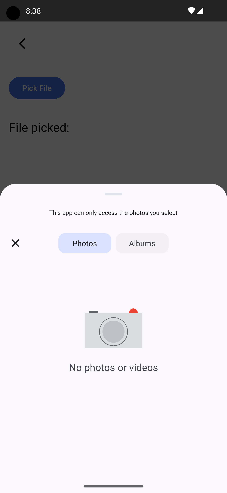
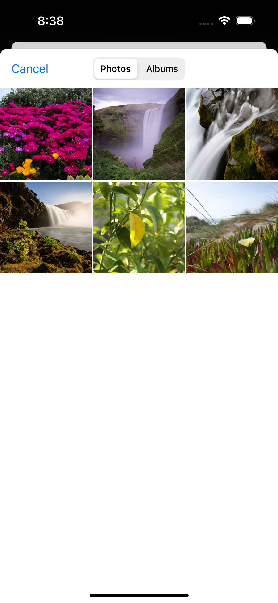
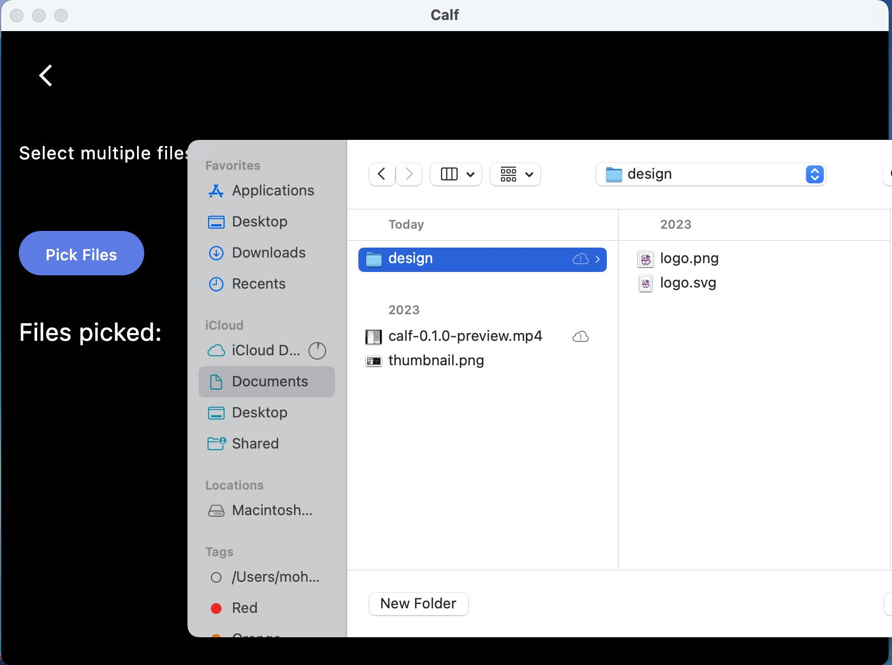
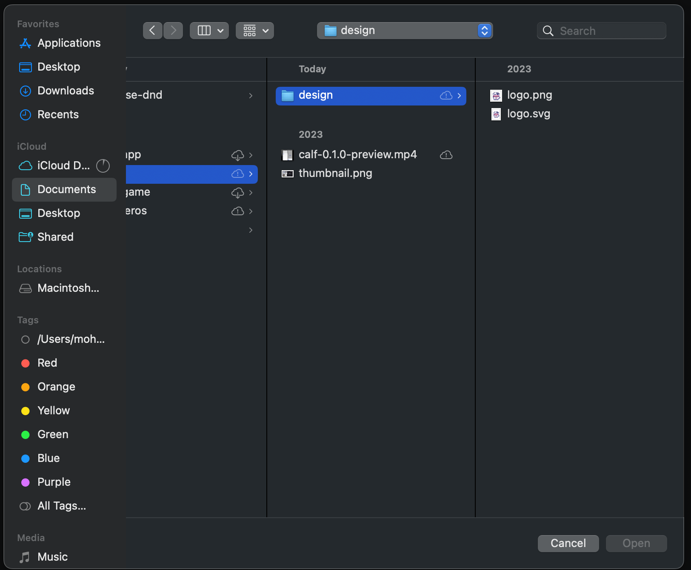

# File Picker

## Installation

[](https://search.maven.org/search?q=g:%22com.mohamedrejeb.calf%22%20AND%20a:%calf-file-picker%22)

```kotlin
implementation("com.mohamedrejeb.calf:calf-file-picker:{{ calf_version }}")
```

## Quick Start

| Android                                                       | iOS                                                   |
|---------------------------------------------------------------|-------------------------------------------------------|
|  |  |

| Desktop                                                       | Web                                                   |
|---------------------------------------------------------------|-------------------------------------------------------|
|  |  |

```kotlin
val scope = rememberCoroutineScope()

val pickerLauncher = rememberFilePickerLauncher(
    type = FilePickerFileType.Image,
    selectionMode = FilePickerSelectionMode.Single,
    onResult = { files ->
        scope.launch {
            files.firstOrNull()?.let { file ->
                // Do something with the selected file
                // You can get the ByteArray of the file
                file.readByteArray()
            }
        }
    }
)

Button(
    onClick = {
        pickerLauncher.launch()
    },
    modifier = Modifier.padding(16.dp)
) {
    Text("Open File Picker")
}
```

## Error Handling

Pass `onError` to observe failures: no app on the device can pick files, the dialog could not be shown (for example, the Desktop native library failed to load), or picked files could not be read. Cancelling is not a failure; `onResult` receives an empty list.

```kotlin
val pickerLauncher = rememberFilePickerLauncher(
    type = FilePickerFileType.Pdf,
    onError = { error: FilePickerException -> showMessage("Could not pick: ${error.message}") },
    onResult = { files -> /* ... */ },
)
```

When only some of the picked files fail, `onError` is called once and `onResult` still receives the files that could be read. Without `onError`, failures are not reported.

## Settings

Use `FilePickerSettings` to customize the dialog behavior:

```kotlin
val pickerLauncher = rememberFilePickerLauncher(
    type = FilePickerFileType.Image,
    settings = FilePickerSettings(
        title = "Select an image",
        initialDirectory = "/home/user/Pictures",
    ),
    onResult = { files -> /* ... */ }
)
```

Or use `rememberFilePickerSettings` inside a `@Composable` to automatically recompose when settings change:

```kotlin
val settings = rememberFilePickerSettings(
    title = dialogTitle,
    initialDirectory = selectedDirectory,
)

val pickerLauncher = rememberFilePickerLauncher(
    type = FilePickerFileType.Image,
    settings = settings,
    onResult = { files -> /* ... */ }
)
```

Common properties available on all platforms:

- `title` - Dialog window title
- `initialDirectory` - Directory to open the dialog in (see [Opening in a picked folder](#opening-in-a-picked-folder))
- `imageRepresentationMode` - Controls how iOS returns image assets (see [iOS Image Representation](#ios-image-representation))

### Opening in a picked folder

To open the dialog in a folder the user picked earlier, pass the folder's `KmpFile` as `initialDirectory`. Calf hands it to each platform in the form it expects: its path on Desktop, its URI on Android (a picked folder is a `content:` tree URI with no path), and its URL on iOS:

```kotlin
var folder by remember { mutableStateOf<KmpFile?>(null) }

val folderPicker = rememberFilePickerLauncher(
    type = FilePickerFileType.Folder,
    onResult = { files -> folder = files.firstOrNull() },
)

val filePicker = rememberFilePickerLauncher(
    type = FilePickerFileType.Pdf,
    settings = rememberFilePickerSettings(initialDirectory = folder),
    onResult = { files -> /* ... */ },
)
```

| Platform | Where `initialDirectory` applies |
|---|---|
| Android | The folder picker (`OpenDocumentTree`) |
| iOS | The document picker and the save dialog (`directoryURL`); the photo picker has no folders |
| Desktop | Every dialog |
| Web | Ignored, browsers cannot open a dialog in a given folder |

The `String` overload is still available, for example for a path typed on Desktop.

Desktop adds an additional property:

- `parentWindow` - The `ComposeWindow` to attach the dialog to (see [Desktop Setup](#desktop-setup))

### iOS Image Representation

By default, the iOS photo picker transcodes images to a compatible format (e.g. HEIC → JPEG) so they can be displayed with Compose/Skia. If you need the original format (HEIC, RAW, etc.), set `imageRepresentationMode` to `Current`:

```kotlin
val settings = FilePickerSettings(
    imageRepresentationMode = ImageRepresentationMode.Current,
)
```

- `ImageRepresentationMode.Compatible` (default) - Transcodes to JPEG. Recommended for displaying images with Compose.
- `ImageRepresentationMode.Current` - Returns original format. Use when you handle decoding yourself or need original quality.

> This setting only affects iOS. It is ignored on other platforms.

## File Types

`FilePickerFileType` controls which files the user can select:

- `FilePickerFileType.Image` - Images only
- `FilePickerFileType.Video` - Videos only
- `FilePickerFileType.ImageVideo` - Images and videos
- `FilePickerFileType.Audio` - Audio files only
- `FilePickerFileType.Document` - Documents only
- `FilePickerFileType.Text` - Text files only
- `FilePickerFileType.Pdf` - PDF files only
- `FilePickerFileType.All` - All file types
- `FilePickerFileType.Folder` - Folders only

Filter by MIME type:

```kotlin
val type = FilePickerFileType.Custom(
    listOf("text/plain")
)
```

Filter by extension:

```kotlin
val type = FilePickerFileType.Extension(
    listOf("txt")
)
```

## Selection Modes

- `FilePickerSelectionMode.Single` - Pick a single file
- `FilePickerSelectionMode.Multiple` - Pick multiple files (unlimited)
- `FilePickerSelectionMode.Multiple(maxItems = 5)` - Pick up to 5 files

### Limiting Selection Count

You can limit the number of files the user can select by passing `maxItems` to `Multiple`:

```kotlin
val pickerLauncher = rememberFilePickerLauncher(
    type = FilePickerFileType.Image,
    selectionMode = FilePickerSelectionMode.Multiple(maxItems = 5),
    onResult = { files ->
        // files.size will be at most 5
    }
)
```

On **Android** (visual media picker) and **iOS** (PHPicker), the limit is enforced natively by the picker UI — the user cannot select more than `maxItems` files. On all other platforms and picker types, the result list is truncated to `maxItems` after selection.

Passing `null` (the default) allows unlimited selection. `FilePickerSelectionMode.Multiple` without parentheses is equivalent to `Multiple(maxItems = null)`.

## Desktop Setup

#### Native library cache

The desktop file picker relies on a small native library bundled inside the JAR. On first use it is extracted to `~/.cache/calf-filepicker/`. The cached file name includes a hash of the library's content, so several applications, product flavors, or Calf versions running on the same machine never overwrite each other's copy, and an identical library that is already present is reused as is.

Packagers that place the library on the system library path (for example Conveyor) skip the extraction entirely, since the loader tries `System.loadLibrary` first.

#### macOS Dark Theme

The file dialog follows the application's theme. To enable dark mode support on macOS, add this JVM argument to your Gradle configuration:

```kotlin
compose.desktop {
    application {
        nativeDistributions {
            macOS {
                jvmArgs(
                    "-Dapple.awt.application.appearance=system",
                )
            }
        }
    }
}
```

> Make sure to use the Gradle `run` task. Other run configurations (e.g. `hotRun`, `jvmRun`) may ignore these settings.

#### Parent Window

To attach the file dialog to the current window, you have three options:

#### Option 1: ProvideFilePickerParentWindow (recommended)

Wrap your content with `ProvideFilePickerParentWindow` to automatically provide the parent window to all file pickers in the tree:

```kotlin
fun main() = application {
    Window(onCloseRequest = ::exitApplication) {
        ProvideFilePickerParentWindow {
            App()
        }
    }
}
```

#### Option 2: FrameWindowScope extension

Use the `FrameWindowScope.rememberFilePickerLauncher` extension, which auto-captures the window:

```kotlin
fun main() = application {
    Window(onCloseRequest = ::exitApplication) {
        val pickerLauncher = rememberFilePickerLauncher(
            type = FilePickerFileType.Image,
            onResult = { files -> /* ... */ }
        )
    }
}
```

#### Option 3: Explicit settings

Pass the window directly through `FilePickerSettings`:

```kotlin
val window = LocalFilePickerParentWindow.current

val pickerLauncher = rememberFilePickerLauncher(
    type = FilePickerFileType.Image,
    settings = FilePickerSettings(
        parentWindow = window,
    ),
    onResult = { files -> /* ... */ }
)
```

## Extensions

All `KmpFile` extension functions work without passing a context parameter. On Android, the application context is captured automatically when using `rememberFilePickerLauncher`.

* Read the `ByteArray` of the file using the `readByteArray` extension function:

```kotlin
LaunchedEffect(file) {
    val byteArray = file.readByteArray()
}
```

> The `readByteArray` extension function is a suspending function, so you need to call it from a coroutine scope.

> It's not recommended to use `readByteArray` extension function on large files, as it reads the entire file into memory. See [Streaming with kotlinx-io](#streaming-with-kotlinx-io) to read it as a stream instead.
> For large files, it's recommended to use the platform-specific APIs to read the file.
> You can read more about accessing the platform-specific APIs below.

* Check if the file exists using the `exists` extension function:

```kotlin
val exists = file.exists()
```

* Get the file name using the `getName` extension function:

```kotlin
val name = file.getName()
```

* Get the file system path using the `getPath` extension function. It is a decoded path you can open directly, or `null` when the file has no path:

```kotlin
val path = file.getPath()
```

| Platform | `getPath()` |
|---|---|
| Android | The path of a `file:` URI. `null` for the `content:` URIs the system pickers return; read those with `readByteArray()` or `source()`. |
| iOS | The path of the file the app can read. For a picked file that is the app's copy, for example `…/tmp/calf-file-picker/…/Report Final.pdf`, which keeps the picked file's name. |
| Desktop | The path of the file. |
| Web | Always `null`, browsers do not expose paths. |

* Get the file URI using the `toUriString` extension function, for example to store a reference to the file or to pass a picked folder as the Android `initialDirectory`:

```kotlin
val uri = file.toUriString() // content://… on Android, file:///… on iOS and Desktop, null on Web
```

* Restore a file from a string returned by `toUriString()`, for example one you stored to reopen a folder later. An absolute path works too:

```kotlin
val folder: KmpFile? = KmpFile.fromUriString(savedUri) // null if it is not a file reference, always null on Web
```

> `fromUriString` restores the reference, not access to it. After the app restarts, a `content:` URI on Android needs a persisted URI permission and a picked location on iOS needs a security-scoped bookmark to stay readable.

* Get the size in bytes and the MIME type using the `getSize` and `getMimeType` extension functions. Both return `null` when the value is unknown:

```kotlin
val size: Long? = file.getSize()
val mimeType: String? = file.getMimeType() // e.g. "application/pdf"
```

On Android both come from the content provider, with the file extension as a fallback for the type. iOS and Desktop use the file system and the extension, and the web uses what the browser reports.

> **Migration from 0.14.x:** `getPath()` used to return the URI string on Android (`content://…`) and iOS (`file:///…%20…`), and the file name on Web. Use `toUriString()` where you relied on the URI.

* Check if the file is a directory using the `isDirectory` extension function:

```kotlin
val isDirectory = file.isDirectory()
```

> Overloads that accept a `PlatformContext` parameter are still available for backward compatibility.

## File Saver

`rememberFileSaverLauncher` lets the user save a file to a location of their choice. Available on all platforms.

```kotlin
@OptIn(ExperimentalCalfApi::class)
@Composable
fun SaveFileExample() {
    val saverLauncher = rememberFileSaverLauncher(
        onResult = { file ->
            // file is the saved KmpFile, or null if cancelled
            // In Safari and Firefox, which only download, onResult is not called
        }
    )

    Button(onClick = {
        saverLauncher.launch(
            bytes = myByteArray,
            baseName = "document",
            extension = "pdf",
        )
    }) {
        Text("Save File")
    }
}
```

Pass `onError` to tell a failure apart from a cancellation. A failure is reported only through `onError`: no app can save files, the source could not be read, or the chosen file could not be written. Without `onError`, a failure reaches `onResult` as `null`, like a cancellation.

```kotlin
val saverLauncher = rememberFileSaverLauncher(
    onError = { error -> showMessage("Could not save: ${error.message}") },
    onResult = { file -> /* saved file, or null if cancelled */ },
)
```

### Saving from a KmpFile

If you already have a `KmpFile` (e.g., from a file picker), you can pass it directly instead of loading bytes into memory:

```kotlin
saverLauncher.launch(
    file = pickedFile,
    baseName = "copy",
    extension = "pdf",
)
```

This avoids loading the entire file content into memory. On each platform, the file is copied or streamed directly to the destination chosen by the user.

**Platform behavior:**

| Platform | Mechanism |
|----------|-----------|
| Android | System document creation dialog (`CreateDocument`), typed after `extension` (for example `application/pdf`). Calf writes the source into the created document. |
| iOS | Export dialog (`UIDocumentPickerViewController`) that saves a copy under `baseName.extension`. The source is staged in the app's temporary directory and never moved; the staged copy is removed when the dialog closes. |
| Desktop | Native save dialog via rfd |
| Web | The browser's save dialog (`showSaveFilePicker`) in Chrome, Edge and other Chromium browsers; `onResult` receives the saved file, or `null` if the user cancels. Safari and Firefox have no save dialog API, so the file is downloaded where the browser's settings say and `onResult` is not called. |

If the source cannot be read or written, the failure is reported as described above, and on Android the empty document is deleted.

> **Android process death:** the save dialog runs in another app, so Android may kill yours while it is open. A `KmpFile` source is restored when the result arrives; a `ByteArray` source is not, because it can be larger than the saved instance state allows. In that case saving fails. Save from a `KmpFile` when that matters.

> `rememberFileSaverLauncher` is annotated with `@ExperimentalCalfApi`.

## Platform-specific APIs

KmpFile is a wrapper around platform-specific APIs,
you can access the native APIs for each platform using the following properties:

##### Android
```kotlin
val uri: Uri = kmpFile.uri
```

##### iOS
```kotlin
// Persistent copy — always accessible, use for reading content
val nsUrl: NSURL = kmpFile.url

// Original picker URL — may expire due to iOS security scoping, use for metadata only
val originalNsUrl: NSURL = kmpFile.originalUrl
```

> **Note:** On iOS, file picker URLs are security-scoped and may become inaccessible shortly after
> the picker callback returns. `url` points to a persistent copy in the app's temp directory that
> remains readable and keeps the picked file's name; `getPath()` returns its path. `originalUrl` holds the original picker URL — use it only for metadata
> (e.g., the original file name or URI via `getName()` / `toUriString()`).
>
> **Migration from 0.10.x:** `KmpFile.url` on iOS previously referred to the original picker URL.
> It now points to the persistent copy. If you were using `url` for the original file path,
> switch to `originalUrl`.

##### Desktop
```kotlin
val file: java.io.File = kmpFile.file
```

##### Web
```kotlin
val file: org.w3c.files.File = kmpFile.file
```

## Streaming with kotlinx-io

Reading a large file with `readByteArray` loads it fully into memory. To stream it instead, for example to feed a zip reader or a parser, use the `source()` extension. It opens the file as a [kotlinx-io](https://github.com/Kotlin/kotlinx-io) `RawSource`; kotlinx-io is a dependency of `calf-io`, so nothing extra needs to be added:

```kotlin
import com.mohamedrejeb.calf.io.source

suspend fun importFile(file: KmpFile) {
    file.source().buffered().use { source ->
        val header = source.readByteArray(4)
        // keep reading from `source` in chunks
    }
}
```

`source()` is a suspending function. Like the other extensions it has an overload that takes a `PlatformContext` for Android code that runs outside a Calf composable. Always close the returned source.

| Platform | How the file is opened |
|---|---|
| Android | `ContentResolver.openInputStream`, so content URIs from the Storage Access Framework, Google Drive or Downloads stream directly. `getPath()` is `null` for these URIs, so use `source()` rather than opening a path yourself. |
| iOS, Desktop | From the file system through `SystemFileSystem`. |
| JS, Wasm | Browsers offer no synchronous file reads, so the whole file is read into memory first and served from a `Buffer`. |

### Using okio

If your code is built on [okio](https://square.github.io/okio/), convert the source with the official [kotlinx-io-okio](https://github.com/Kotlin/kotlinx-io) bridge:

```kotlin
implementation("org.jetbrains.kotlinx:kotlinx-io-okio:<kotlinx-io version>")
```

```kotlin
import kotlinx.io.okio.asOkioSource

val okioSource: okio.Source = file.source().asOkioSource()
```

## Coil Extensions

In case you're using [Coil](https://github.com/coil-kt/coil) in your project, Calf has a dedicated package that includes utilities to ease the integration between both libraries.

You can use it by adding the following dependency to your module `build.gradle.kts` file:

```kotlin  
implementation("com.mohamedrejeb.calf:calf-file-picker-coil:{{ calf_version }}")  
```  

Currently, this package contains a `KmpFileFetcher` that you can use to let Coil know how to load a KmpFile by adding it to Coil's  `ImageLoader`:

```kotlin  
ImageLoader.Builder(context)  
 .components { add(KmpFileFetcher.Factory()) }
 .build()  
```  

For more info regarding how to extend the Image Pipeline in Coil, you can read [here](https://coil-kt.github.io/coil/image_pipeline/).
