<p align="center">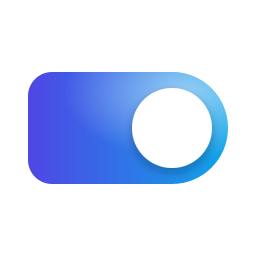</p>

# Calf - Compose Adaptive Look & Feel

Write your UI once in Compose Multiplatform. Calf gives it the native look and feel on every platform: Material 3 on Android, Desktop and Web, Cupertino and Liquid Glass on iOS, real UIKit navigation, and the system APIs an app needs (file picker, camera, share sheet, permissions, WebView).

[](http://kotlinlang.org)
[](https://www.jetbrains.com/lp/compose-multiplatform)
[](https://github.com/MohamedRejeb)
[](https://opensource.org/licenses/Apache-2.0)
[](https://search.maven.org/search?q=g:%22com.mohamedrejeb.calf%22%20AND%20a:%calf-ui%22)

<p align="center">
  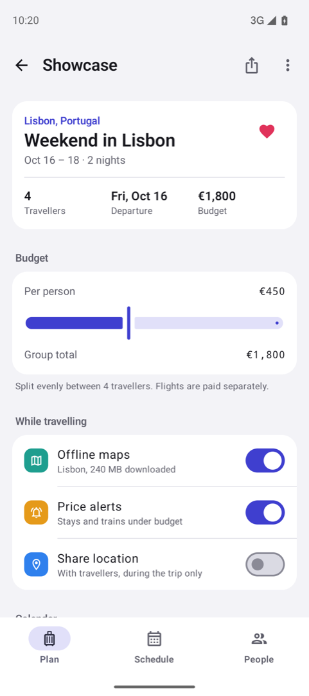
  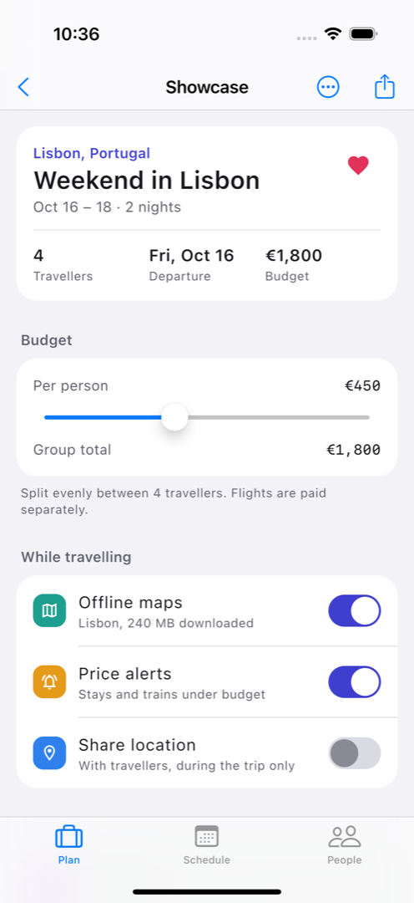
  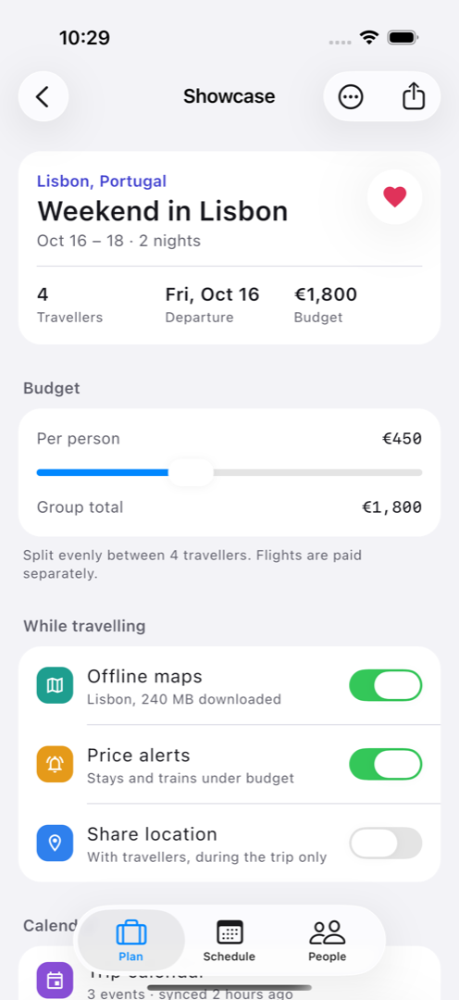
</p>
<p align="center"><sub>One screen, no platform code: Material 3 on Android · Cupertino on iOS 18 · Liquid Glass on iOS 26</sub></p>

<!-- MEDIA: iPhone Duo closed → open: the sample's home becomes list + detail, the bars move into the vertical strip -->

Calf stands for **C**ompose **A**daptive **L**ook & **F**eel. Try the [web demo](https://calf-library.netlify.app/) or read the [documentation](https://mohamedrejeb.github.io/Calf/).

## Why Calf

- **Adaptive components.** Buttons, switches, sliders, pickers, dialogs, sheets, menus, toolbars, top bars and tab bars. One API: Material 3 on Android, Desktop and Web, native UIKit (Cupertino, and Liquid Glass on iOS 26) on iOS.
- **Native navigation.** `calf-navigation` wraps Navigation 3 with a real `UINavigationController`, `UITabBarController` and `UISplitViewController` on iOS: system push and pop, edge swipe-back, large titles, split view. Material 3 adaptive scaffolds everywhere else. Prefer plain Navigation 3? The bar host keeps the iOS bars in place across your own transitions.
- **Foldables and iPhone Duo.** `calf-foldable` reads the posture, the fold and the camera area on Android foldables and on iPhone Duo, and lays out panes around the fold. The navigation containers put their bars in the Duo's vertical strip and align the split view to the fold.
- **Platform APIs.** File picker, image picker with Coil, camera, file saving, share sheet, WebView and runtime permissions, each one a small Compose API over the system implementation.
- **1300+ Cupertino icons** rendered on every platform.

## Quick start

```kotlin
// build.gradle.kts (commonMain)
implementation("com.mohamedrejeb.calf:calf-ui:{{ calf_version }}")
```

```kotlin
var enabled by remember { mutableStateOf(true) }

AdaptiveSwitch(checked = enabled, onCheckedChange = { enabled = it })
AdaptiveButton(onClick = { save() }) { Text("Save") }
```

That is a Material 3 switch and button on Android, Desktop and Web, a `UISwitch` and a `UIButton` on iOS, and a Liquid Glass button on iOS 26. See [Installation](https://mohamedrejeb.github.io/Calf/installation/) for the full list of artifacts and the Kotlin / Compose compatibility table.

## Components

Every component is documented with its parameters and platform notes. Each cell links to its page.

| | | | |
|:---:|:---:|:---:|:---:|
| <a href="https://mohamedrejeb.github.io/Calf/ui/adaptive-button/">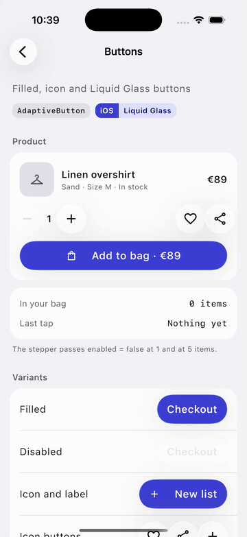<br/>Button</a> | <a href="https://mohamedrejeb.github.io/Calf/ui/adaptive-switch/">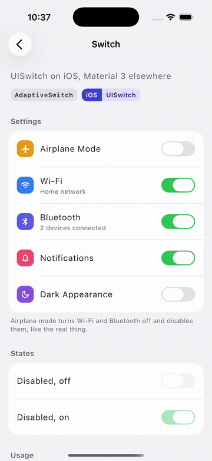<br/>Switch</a> | <a href="https://mohamedrejeb.github.io/Calf/ui/adaptive-slider/">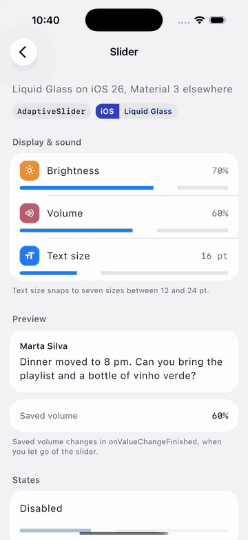<br/>Slider</a> | <a href="https://mohamedrejeb.github.io/Calf/ui/adaptive-toolbar/">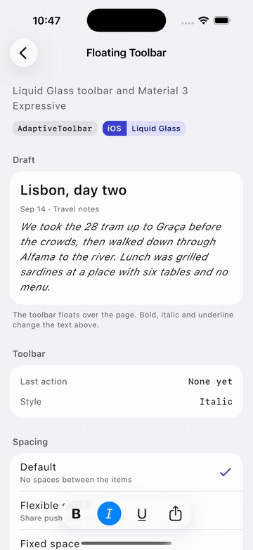<br/>Toolbar</a> |
| <a href="https://mohamedrejeb.github.io/Calf/ui/adaptive-alert-dialog/">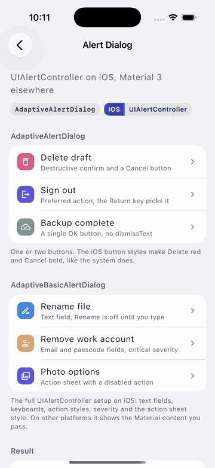<br/>Alert Dialog</a> | <a href="https://mohamedrejeb.github.io/Calf/ui/adaptive-bottom-sheet/">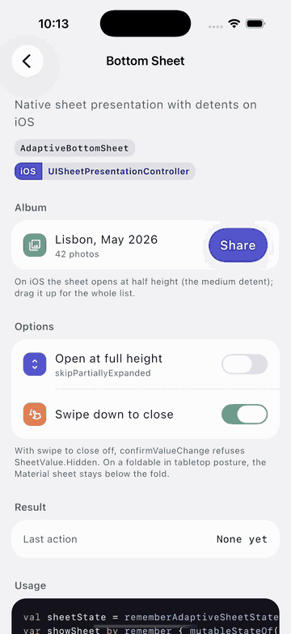<br/>Bottom Sheet</a> | <a href="https://mohamedrejeb.github.io/Calf/ui/adaptive-drop-down/">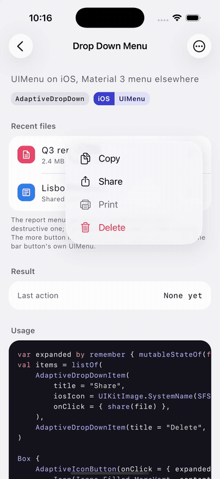<br/>Drop Down Menu</a> | <a href="https://mohamedrejeb.github.io/Calf/ui/adaptive-clickable/">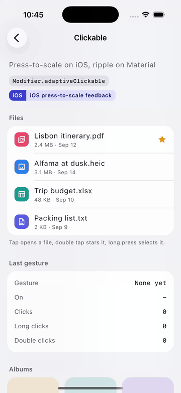<br/>Clickable</a> |
| <a href="https://mohamedrejeb.github.io/Calf/ui/adaptive-date-picker/">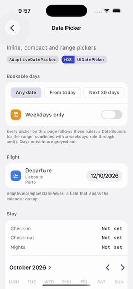<br/>Date Picker</a> | <a href="https://mohamedrejeb.github.io/Calf/ui/adaptive-time-picker/">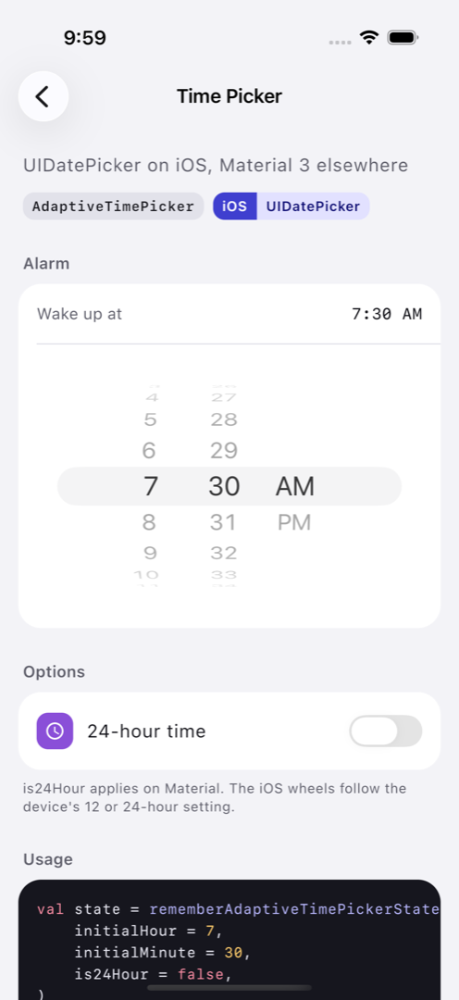<br/>Time Picker</a> | <a href="https://mohamedrejeb.github.io/Calf/ui/adaptive-circular-progress-indicator/">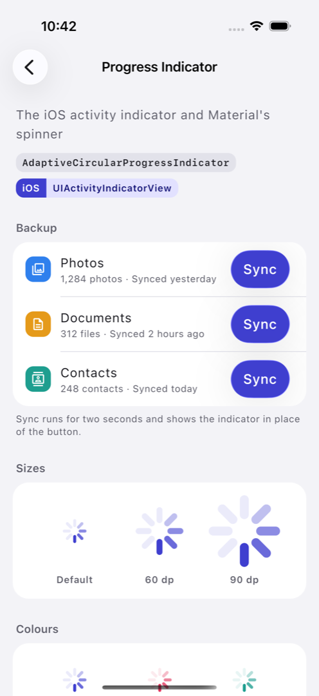<br/>Progress Indicator</a> | <a href="https://mohamedrejeb.github.io/Calf/sf-symbols/">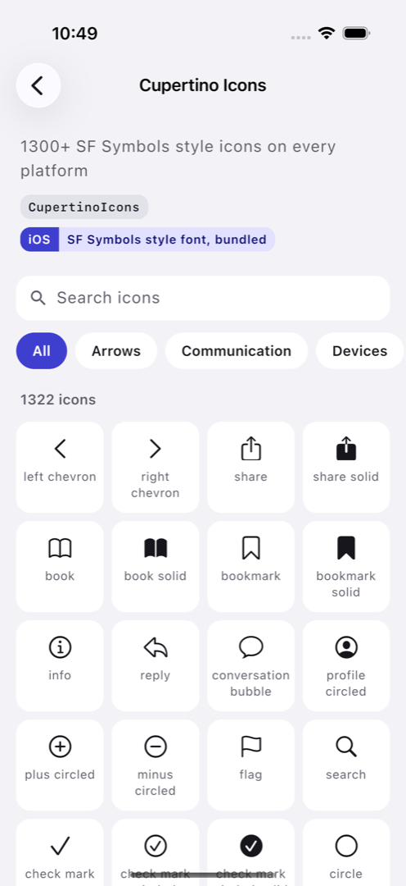<br/>Cupertino Icons</a> |
| <a href="https://mohamedrejeb.github.io/Calf/ui/adaptive-top-bar/">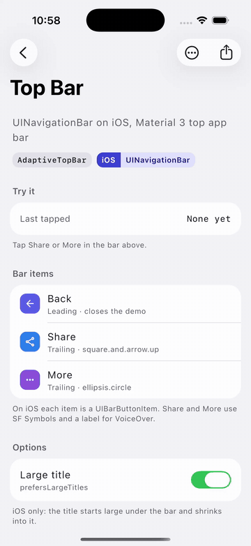<br/>Top Bar</a> | <a href="https://mohamedrejeb.github.io/Calf/ui/adaptive-navigation-bar/">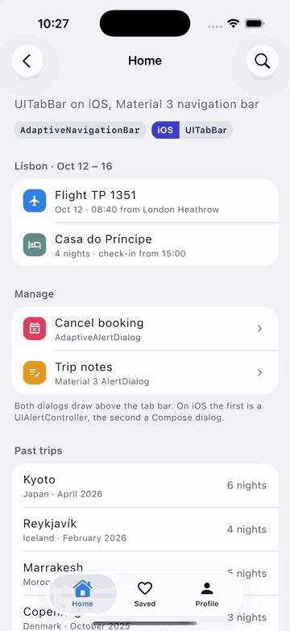<br/>Navigation Bar</a> | <a href="https://mohamedrejeb.github.io/Calf/ui/">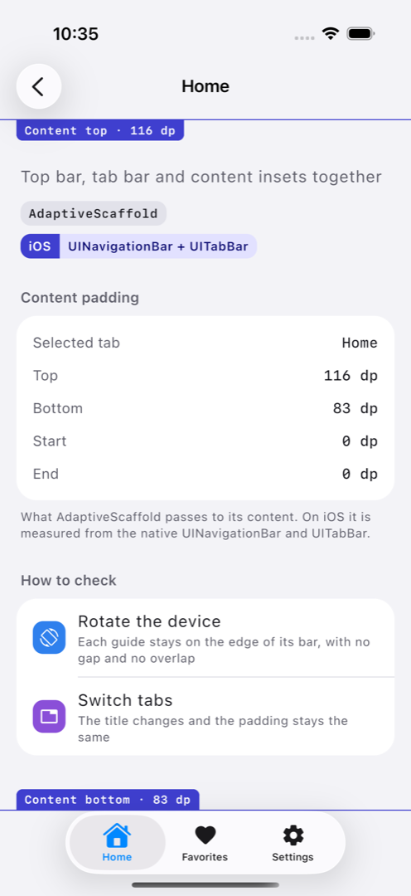<br/>Scaffold</a> | <a href="https://mohamedrejeb.github.io/Calf/ui/adaptive-icon-button/">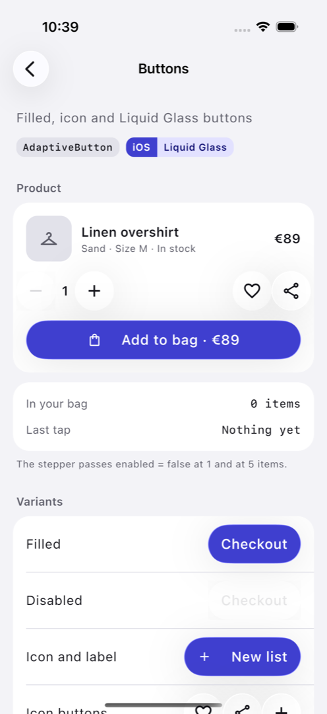<br/>Icon Button</a> |

## Navigation

`calf-navigation` is Navigation 3 with native containers. The Compose back stack stays the single source of truth; on iOS each entry is pushed on a `UINavigationController`, tabs are a `UITabBarController` and list-detail is a `UISplitViewController`, so you get the system push and pop, the edge swipe-back, large titles that collapse, and two columns on iPad and on an open iPhone Duo.

| Material 3 | iOS 18 | iOS 26 |
|:---:|:---:|:---:|
| 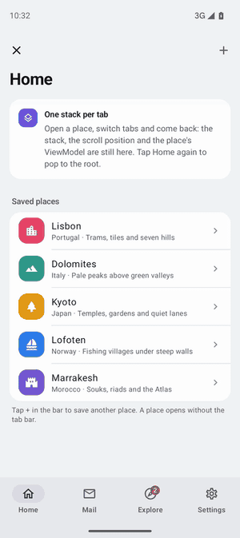 | 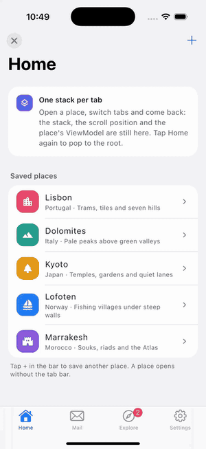 | 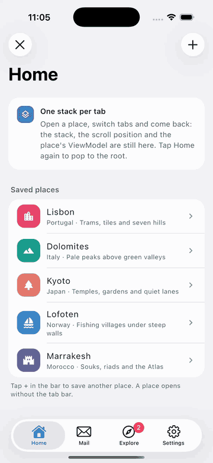 |

```kotlin
val backStack = rememberAdaptiveNavBackStack(Home)

AdaptiveNavDisplay(backStack) { key ->
    when (key) {
        is Home -> adaptiveNavEntry(key, title = { Text("Home") }, iosTitle = "Home", largeTitle = true) { padding ->
            HomeScreen(padding, onItemClick = { backStack.add(Detail(it)) })
        }
        is Detail -> adaptiveNavEntry(key, title = { Text("Item") }, iosTitle = "Item", iosBackTitle = "Home") { padding ->
            DetailScreen(key.itemId, padding)
        }
    }
}
```

Keeping plain Navigation 3 for shared elements and custom transitions? The [bar host](https://mohamedrejeb.github.io/Calf/ui/#installing-the-bar-host-ios) keeps your iOS top bar, toolbar and tab bar in place while your screens animate, and `calf-foldable-navigation3` adds a fold-aware two-pane scene strategy. [Which path do I pick?](https://mohamedrejeb.github.io/Calf/navigation/#which-path-do-i-pick)

## Foldables and iPhone Duo

`calf-foldable` exposes the posture (closed, half open, flat), how far the device is open, the fold's position and the area the camera reserves, on Android foldables and on iPhone Duo, with `FoldPanes` to lay content out around the fold: side by side like a book, or above and below like a laptop. The sample's Foldable screen draws every value live.

| Android foldable | iPhone |
|:---:|:---:|
| 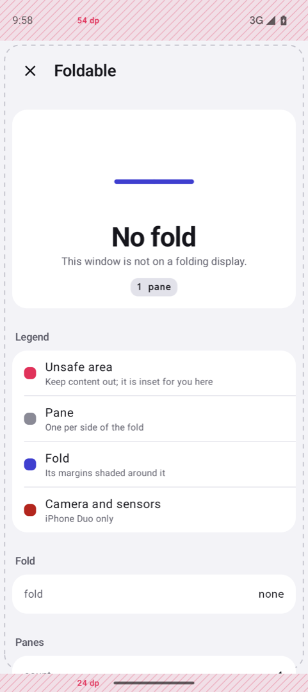 | 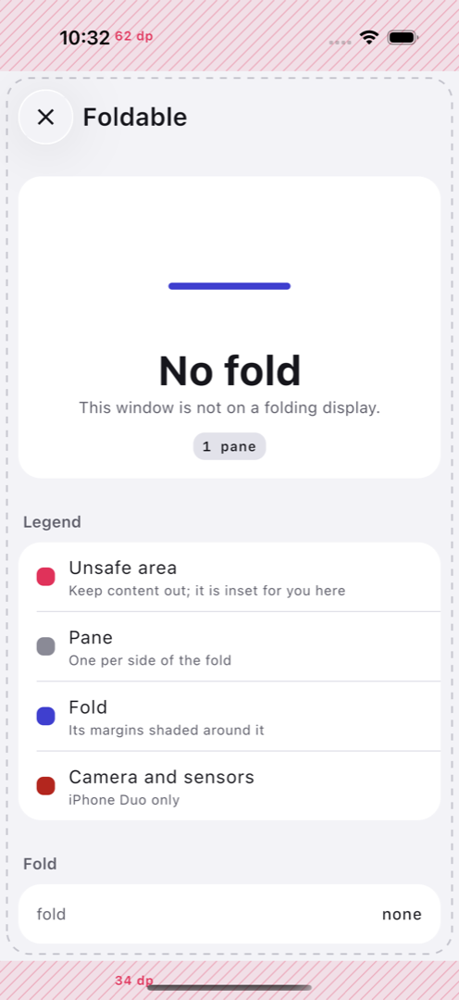 |

| Book | Open |
| --- | --- |
| 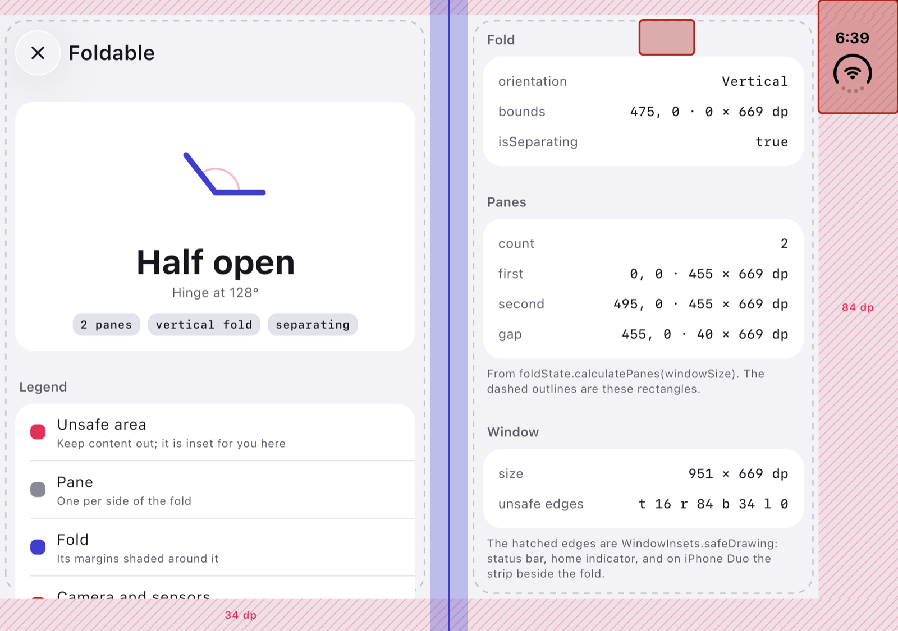 | 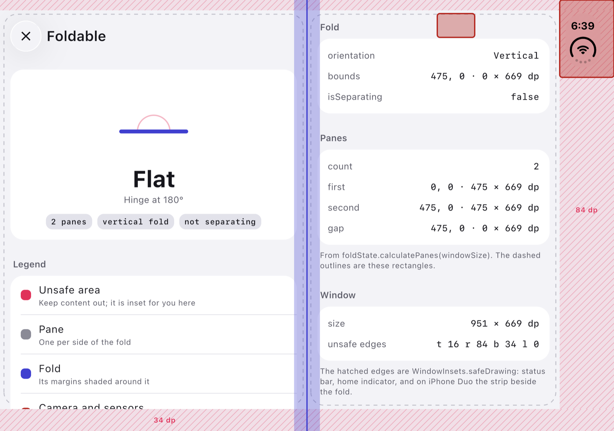 |

Read [Foldable](https://mohamedrejeb.github.io/Calf/foldable/) for the API and the list-detail strategies.

## Platform APIs

Small Compose APIs over the system implementation. No Flutter-style plugin channel, no platform code in your app.

| File picker | Image picker | Share | File saver |
|:---:|:---:|:---:|:---:|
| 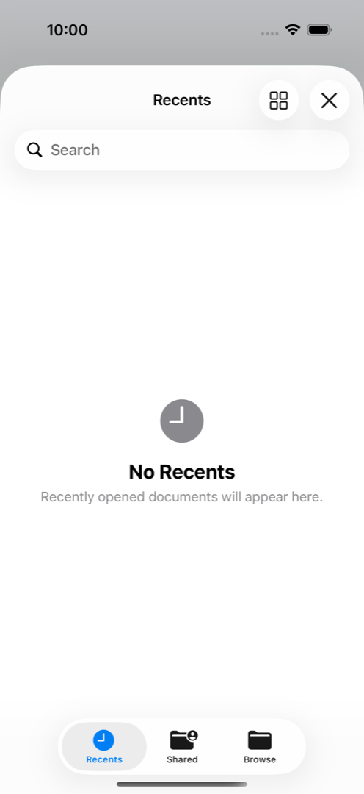 | 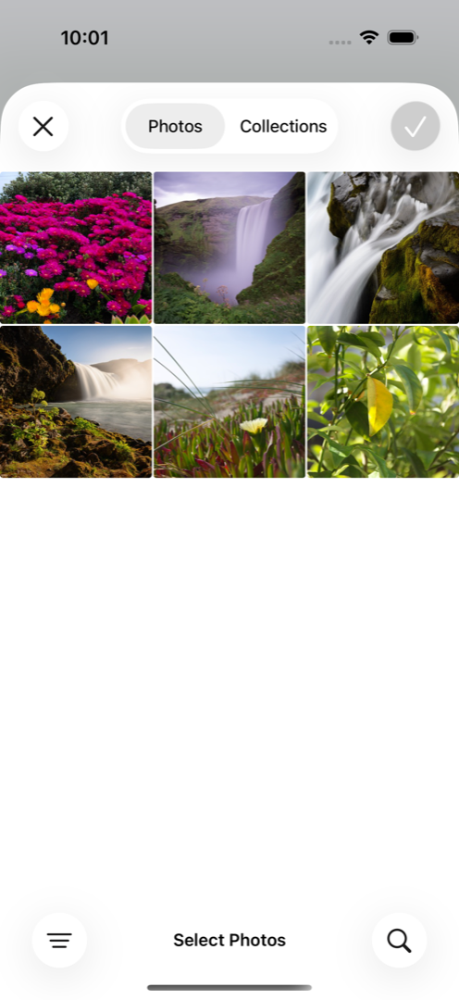 | 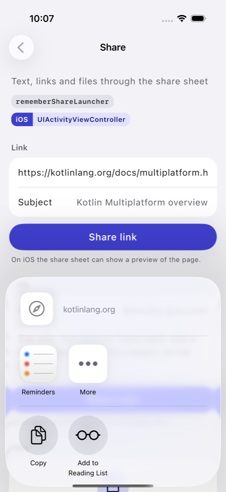 | 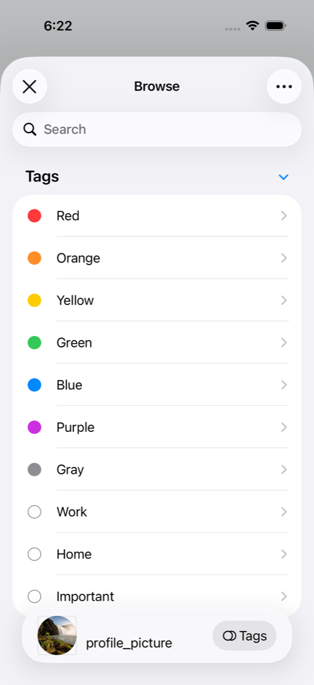 |
| [`calf-file-picker`](https://mohamedrejeb.github.io/Calf/filepicker/) | [`calf-file-picker-coil`](https://mohamedrejeb.github.io/Calf/filepicker/) | [`calf-share`](https://mohamedrejeb.github.io/Calf/share/) | [`calf-file-picker`](https://mohamedrejeb.github.io/Calf/filepicker/#file-saver) |

| Permissions | WebView |
|:---:|:---:|
| 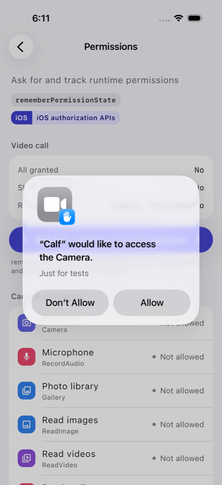 | 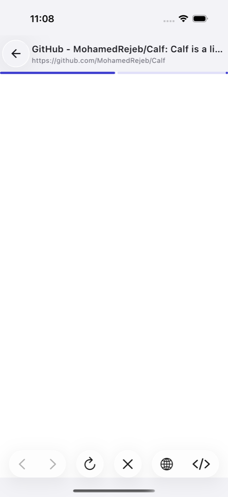 |
| [`calf-permissions`](https://mohamedrejeb.github.io/Calf/permissions/) | [`calf-webview`](https://mohamedrejeb.github.io/Calf/webview/) |

`calf-camera-picker` opens the system camera the same way (Android and iOS; a no-op on Desktop and Web).

```kotlin
val picker = rememberFilePickerLauncher(type = FilePickerFileType.Image) { files ->
    files.firstOrNull()?.let { show(it) }
}
AdaptiveButton(onClick = { picker.launch() }) { Text("Pick a photo") }
```

## Artifacts

| Artifact | Description | Platforms |
|---|---|---|
| **calf-ui** | Adaptive UI components, scaffold and bars, the iOS bar host | Android, iOS, Desktop, Web (JS, Wasm) |
| **calf-navigation** | Navigation 3 with native stacks, tabs and split view on iOS | Android, iOS, Desktop, Web (JS, Wasm) |
| **calf-foldable** | Fold state, posture, camera area and panes (Android foldables, iPhone Duo) | Android, iOS, Desktop, Web (JS, Wasm) |
| **calf-foldable-navigation3** | Fold-aware list-detail scene strategy for plain Navigation 3 | Android, iOS, Desktop, Web (JS, Wasm) |
| **calf-file-picker** | System file and image picker | Android, iOS, Desktop, Web (JS, Wasm) |
| **calf-file-picker-coil** | Coil fetcher for picked files | Android, iOS, Desktop, Web (JS, Wasm) |
| **calf-camera-picker** | Take a photo with the system camera (no-op on Desktop and Web) | Android, iOS |
| **calf-io** | `KmpFile`: read, write and save files across platforms | Android, iOS, Desktop, Web (JS, Wasm) |
| **calf-share** | Share text, links and files through the system share sheet | Android, iOS, Desktop, Web (JS, Wasm) |
| **calf-webview** | WebView component | Android, iOS, Desktop, Web (JS, Wasm) |
| **calf-permissions** | Runtime permissions, one module per permission (`calf-permissions-camera`, `-gallery`, `-location`, `-background-location`, `-bluetooth`, `-contacts`, `-calendar`, `-notifications`, `-wifi`, `-microphone`) | Android, iOS |
| **calf-cupertino-icons** | 1300+ SF Symbols style icons | Android, iOS, Desktop, Web (JS, Wasm) |
| **calf-core** | Shared types used by the other modules | Android, iOS, Desktop, Web (JS, Wasm) |

All artifacts are published under `com.mohamedrejeb.calf` with the same version: [](https://search.maven.org/search?q=g:%22com.mohamedrejeb.calf%22). Maps, geolocation and a media player are in progress.

## Compatibility

| Kotlin version | Compose version | Calf version |
|----------------|-----------------|--------------|
| 2.4.20         | 1.12.0          | 0.14.0       |
| 2.4.10         | 1.11.1          | 0.13.0       |
| 2.3.20         | 1.10.3          | 0.12.0       |
| 2.3.20         | 1.10.3          | 0.11.0       |
| 2.3.20         | 1.10.3          | 0.10.0       |
| 2.2.21         | 1.9.2           | 0.9.0        |
| 2.1.21         | 1.8.0           | 0.8.0        |
| 2.1.10         | 1.7.3           | 0.7.1        |
| 2.1.0          | 1.7.3           | 0.7.0        |
| 2.0.21         | 1.7.0           | 0.6.1        |
| 2.0.10         | 1.6.11          | 0.5.5        |
| 1.9.22         | 1.6.0           | 0.4.1        |
| 1.9.21         | 1.5.11          | 0.3.1        |
| 1.9.20         | 1.5.10          | 0.2.0        |
| 1.9.0          | 1.5.0           | 0.1.1        |

> **Android:** Calf 0.14.0+ is built on Compose Multiplatform 1.12, whose Android artifacts require `compileSdk = 37` (Android Gradle Plugin 9.4 is the first release that supports it). Calf's Android `minSdk` stays 23.

> **iOS:** Calf sets no deployment target of its own; your Kotlin framework's `osVersionMin` applies (Kotlin 2.4's default is iOS 15, which is also the lowest target Xcode 27 accepts). iOS 26 components fall back to their Cupertino look on earlier versions, and the iPhone Duo values are read only on iOS 27.1 and later, with a "no fold" answer elsewhere.

## Documentation

- [Installation](https://mohamedrejeb.github.io/Calf/installation/)
- [Adaptive UI](https://mohamedrejeb.github.io/Calf/ui/) and one page per component
- [Adaptive Navigation](https://mohamedrejeb.github.io/Calf/navigation/)
- [Foldable](https://mohamedrejeb.github.io/Calf/foldable/)
- [File Picker](https://mohamedrejeb.github.io/Calf/filepicker/)
- [Content Sharing](https://mohamedrejeb.github.io/Calf/share/)
- [WebView](https://mohamedrejeb.github.io/Calf/webview/)
- [Permissions](https://mohamedrejeb.github.io/Calf/permissions/)
- [SF Symbols & Cupertino Icons](https://mohamedrejeb.github.io/Calf/sf-symbols/)

The sample app in [`sample/`](https://github.com/MohamedRejeb/Calf/tree/main/sample) runs on Android, iOS, Desktop and Web and has a screen for every feature above.

---

<div align="center"><a href="https://github.com/Safouene1/support-palestine-banner/blob/master/Markdown-pages/Support.md"></a></div>

## Contribution
If you've found an error in this sample, please file an issue. <br>
Feel free to help out by sending a pull request :heart:.

[Code of Conduct](https://github.com/MohamedRejeb/Calf/blob/main/CODE_OF_CONDUCT.md)

## Find this library useful? :heart:
Support it by joining __[stargazers](https://github.com/MohamedRejeb/Calf/stargazers)__ for this repository. :star: <br>
Also, __[follow me](https://github.com/MohamedRejeb)__ on GitHub for more libraries! 🤩

You can always <a href="https://www.buymeacoffee.com/MohamedRejeb" target="_blank"></a>

## 🙏 Credits

Special thanks to:
- [compose-cupertino](https://github.com/alexzhirkevich/compose-cupertino)
- [AndroidLiquidGlass](https://github.com/Kyant0/AndroidLiquidGlass)

# License
```
Copyright 2023 Mohamed Rejeb

Licensed under the Apache License, Version 2.0 (the "License");
you may not use this file except in compliance with the License.
You may obtain a copy of the License at

   http://www.apache.org/licenses/LICENSE-2.0

Unless required by applicable law or agreed to in writing, software
distributed under the License is distributed on an "AS IS" BASIS,
WITHOUT WARRANTIES OR CONDITIONS OF ANY KIND, either express or implied.
See the License for the specific language governing permissions and
limitations under the License.
```
