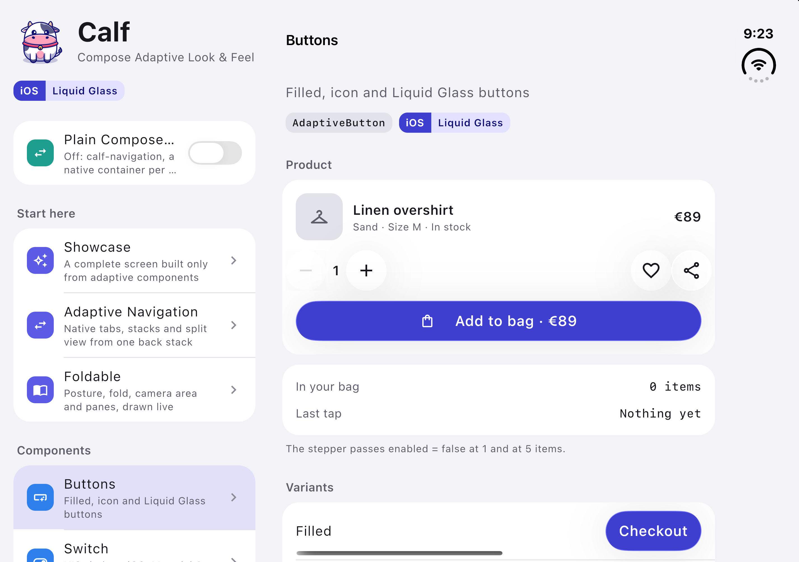
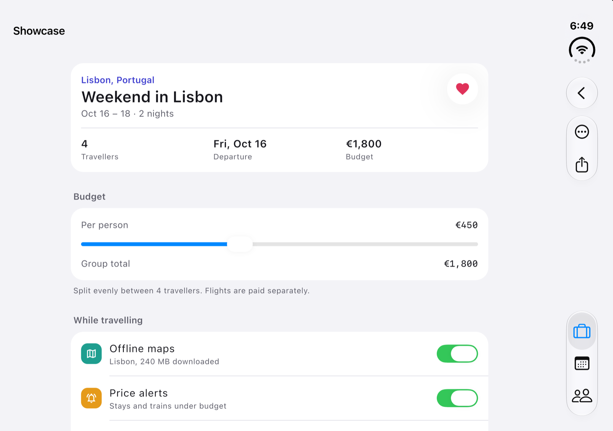
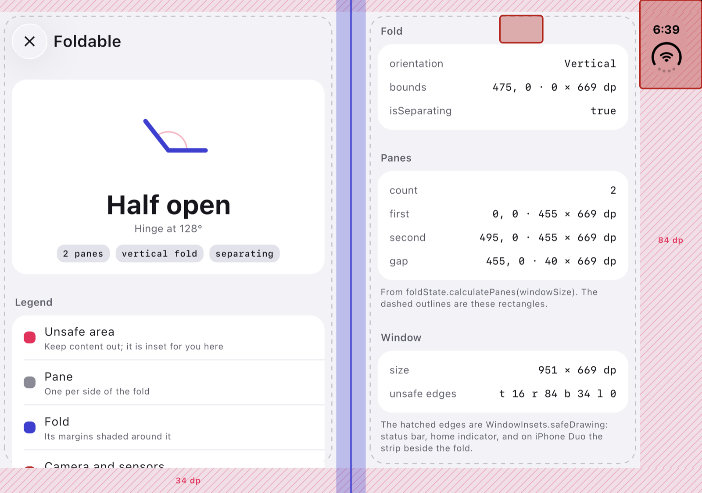
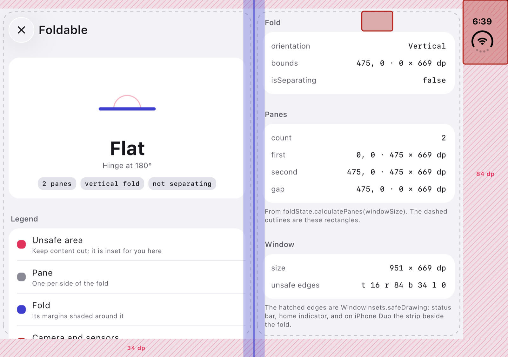

# iPhone Duo

iPhone Duo is Apple's folding iPhone: a cover display of iPhone size, and an inner display of iPad-mini size with
a fold down the middle. iOS 27.1 adds system behaviour for it, and Calf passes that behaviour on to a Compose
Multiplatform app without platform code. This page gathers what Calf does on the Duo and where each part is
documented; everything on it also works on Android foldables, iPad and ordinary iPhones.

## What you get, module by module

| Behaviour | Module | Where |
|---|---|---|
| The posture (closed, half open, flat), the hinge angle, the fold's position and the camera area, as Compose state | `calf-foldable` | [Foldable](foldable.md) |
| Panes laid out around the fold: side by side like a book, above and below like a laptop | `calf-foldable` (`FoldPanes`, `calculatePanes`) | [Foldable › Panes](foldable.md#panes) |
| Two panes on the open Duo in plain Navigation 3, the fold between them | `calf-foldable-navigation3` | [Foldable › Navigation 3](foldable.md#navigation-3-two-panes-around-the-fold) |
| The system split view with its list column aligned to the fold; one pane when closed, two when open | `calf-navigation` (`listDetail`) | [Adaptive Navigation › List-detail](navigation.md#list-detail) |
| The bar button items and the tab bar in the vertical strip, with an overflow menu | `calf-navigation` | [Bar items on iPhone Duo](navigation.md#bar-items-on-iphone-duo) |
| The same vertical strip for plain Compose navigation with Calf's bars | `calf-ui` bar host | [Installing the bar host](ui.md#installing-the-bar-host-ios) |
| Sheets and alerts that keep clear of the strip, action sheets centred in their column | `calf-ui` | [Bottom Sheet](ui/adaptive-bottom-sheet.md), [Alert Dialog](ui/adaptive-alert-dialog.md) |

## Closed, half open, open

On the cover display the Duo is an iPhone: one pane, the bar items and the tab bar in a vertical strip on
one side of the content (iOS places the strip, Calf insets the content). Opened flat, the inner display is a
regular-width window like an iPad mini: a list-detail stack becomes two columns, tabs may become a sidebar (`iosSidebarAdaptable`),
and in landscape the strip comes back. Half open, iOS lines the split view's list column up with the fold,
and `calf-foldable` reports the fold so your own layouts can do the same.

| Device state | `calf-foldable` posture | `calf-navigation` list-detail | Bars |
|---|---|---|---|
| Closed (cover display) | `Closed` | One pane | Vertical strip |
| Half open | `HalfOpen`, with the fold and the hinge angle | Two columns, the list column ends at the fold | Vertical strip in landscape, system bars in portrait |
| Open flat | `Flat`, with the fold | Two columns, system widths | Same |
| Any iPhone, iOS before 27.1 | `NoFold` | One pane | System bars |

<!-- MEDIA: iPhone Duo closed → open: the sample's home becomes list + detail, the bars move into the vertical strip -->

## Two ways to navigate

Both of Calf's navigation paths get the Duo. `calf-navigation` hands each screen to a UIKit container, so
the split view, the strip and the overflow menu are the system's. Plain Navigation 3 keeps your transitions
and shared elements in Compose; the bar host moves one set of Calf bars into the strip, and
`calf-foldable-navigation3` gives the list-detail scene two panes around the fold.
[Which path do I pick?](navigation.md#which-path-do-i-pick) compares them line by line.

## Things to know

- **Name every image bar item** (`label`). The strip's overflow menu and VoiceOver list items by name; a Compose
  vector has none. `visibilityPriority` decides what overflows first. See
  [Bar items on iPhone Duo](navigation.md#bar-items-on-iphone-duo).
- **A tab bar inside an outer stack shares the strip badly** (iOS 27.1): UIKit sizes the items as if the tab bar
  were not there. Keep to three image items per side on a screen that shows the tab bar, or hide it with
  `tabBarShown = false` on a screen that needs more.
- **Tab bar colors stay out of the strip** (iOS 27.1): there the items show their images only and the selected
  one is drawn in the system color, whatever `UIKitTabBarConfiguration` sets. Painter and vector images move
  with the bar.
- **Start a list-detail stack at the list.** Entries below the list are shown inside the narrow list column on
  iOS.
- **Build with Xcode 27.1 or later** to run on a Duo; the fold values are read through a runtime lookup, so the
  same Calf artifacts build with older Xcodes and answer "no fold" on devices without one.
- **Simulator:** the iPhone Duo simulator runs through Device Hub, with closed, book and open poses and rotation.
  `calf-foldable`'s [previews and tests](foldable.md#previews-and-tests) let you fake a posture anywhere else.

## The sample

The sample app ([`sample/`](https://github.com/MohamedRejeb/Calf/tree/main/sample)) is itself a list-detail
app, so its home becomes two columns on an open Duo. Its Foldable screen draws the posture, the fold, the
camera area and the panes live; the Adaptive Navigation demo's Mail tab shows the split view and the strip;
the "Bar items and overflow" screen shows eight items of mixed kinds and priorities; and the switch at the top
of the home screen runs the same screens on plain Navigation 3 with the bar host.

| Book | Open |
| --- | --- |
|  |  |
