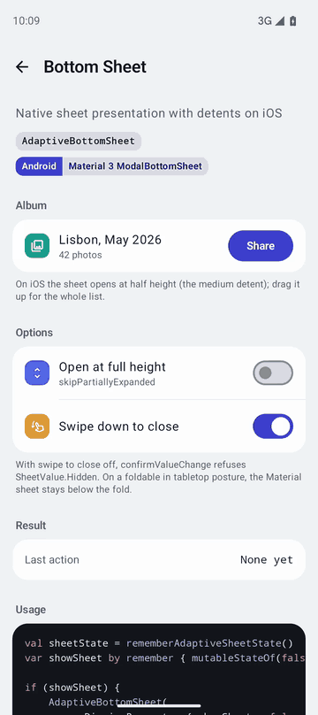
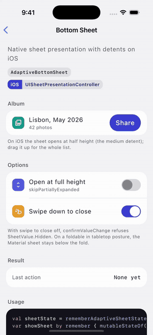
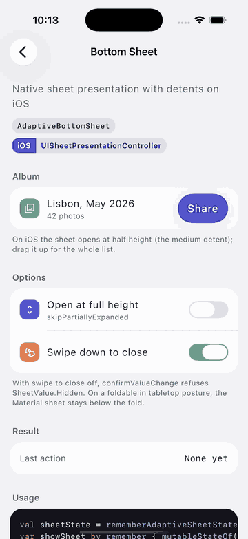
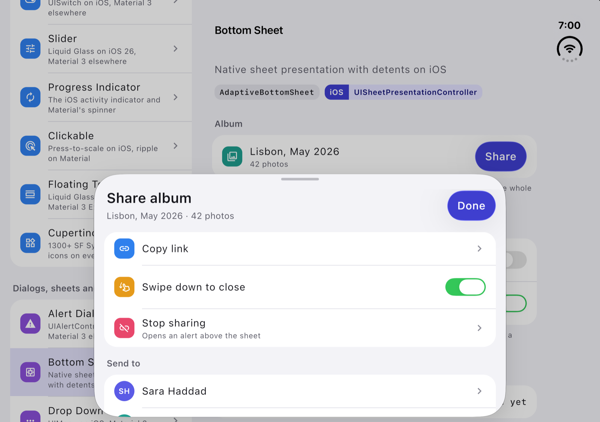

# Bottom Sheet

`AdaptiveBottomSheet` is a bottom sheet that adapts to the platform it is running on. It is a wrapper around `ModalBottomSheet` on Android, Desktop and Web, and a native sheet (`UISheetPresentationController`, with the medium and large detents) on iOS.

| Material (Android, Desktop, Web) | Cupertino (iOS < 26) | Liquid Glass (iOS 26+) |
| --- | --- | --- |
|  |  |  |

## Usage

The `AdaptiveBottomSheet` is typically used to display additional content or actions without navigating away from the current screen. It slides up from the bottom on every platform; on iOS it is the system sheet.

```kotlin
// Create necessary state and scope
val scope = rememberCoroutineScope()
val sheetState = rememberAdaptiveSheetState()
var openBottomSheet by remember { mutableStateOf(false) }

Box(
    modifier = Modifier.fillMaxSize()
) {
    // Button to trigger the bottom sheet
    Button(
        onClick = { openBottomSheet = true },
        modifier = Modifier.align(Alignment.Center)
    ) {
        Text("Show Bottom Sheet")
    }

    // Show the bottom sheet when state is true
    if (openBottomSheet) {
        AdaptiveBottomSheet(
            // Called when the user dismisses the sheet
            onDismissRequest = { openBottomSheet = false },
            // State object to control the sheet
            adaptiveSheetState = sheetState,
            // Optional: Customize the sheet appearance
            shape = RoundedCornerShape(topStart = 16.dp, topEnd = 16.dp),
            // Optional: Set the sheet content color
            containerColor = MaterialTheme.colorScheme.surface,
        ) {
            // Content of the bottom sheet
            Column(
                modifier = Modifier
                    .fillMaxWidth()
                    .padding(16.dp),
                horizontalAlignment = Alignment.CenterHorizontally
            ) {
                Text(
                    "Bottom Sheet Content",
                    style = MaterialTheme.typography.titleLarge,
                    modifier = Modifier.padding(vertical = 8.dp)
                )

                Spacer(modifier = Modifier.height(16.dp))

                // Button to close the sheet programmatically
                Button(
                    onClick = {
                        // Hide the sheet with animation
                        scope.launch { sheetState.hide() }.invokeOnCompletion {
                            // Update the state after animation completes
                            if (!sheetState.isVisible) {
                                openBottomSheet = false
                            }
                        }
                    }
                ) {
                    Text("Close")
                }
            }
        }
    }
}
```

## State

`rememberAdaptiveSheetState` creates the state the sheet is driven and observed through. It survives configuration changes and process death: the sheet's value is saved, and the flags are applied again on restore.

```kotlin
val sheetState = rememberAdaptiveSheetState(
    // No half-height stop: Material drops the anchor, iOS offers the large detent only.
    skipPartiallyExpanded = false,
    // Veto a value change; return false for SheetValue.Hidden to refuse the swipe down.
    confirmValueChange = { true },
    // Where the sheet starts; a visible value shows the sheet at that height when it enters composition.
    initialValue = SheetValue.Hidden,
    // The sheet cannot be hidden by the user, and hide() throws; close it by leaving composition.
    skipHiddenState = false,
)
```

`SheetValue` maps onto the native sheet on iOS: `Expanded` is the large detent, `PartiallyExpanded` the medium one, `Hidden` a sheet that is not presented. `currentValue` follows the user's drags between the two detents, so it reads the same on every platform.

| Member | Material (Android, Desktop, Web) | iOS |
| --- | --- | --- |
| `currentValue`, `targetValue`, `isVisible` | `SheetState`'s | The selected detent; `Hidden` when not presented |
| `hasExpandedState` | Always true | Always true, the large detent is always offered |
| `hasPartiallyExpandedState` | `skipPartiallyExpanded == false`; once laid out, also false when the content is too short for a half-height stop | `skipPartiallyExpanded == false`, the medium detent is offered |
| `show()` | Animates to `PartiallyExpanded` if defined, else `Expanded` | Presents at the medium detent if offered, else the large one |
| `hide()` | Animates to `Hidden`; throws `IllegalStateException` if `skipHiddenState` | Dismisses the sheet; same exception |
| `expand()` | Animates to `Expanded` | Selects the large detent, presenting the sheet first if needed |
| `partialExpand()` | Animates to `PartiallyExpanded`; throws `IllegalStateException` if `skipPartiallyExpanded` | Selects the medium detent, presenting first if needed; same exception |

Every move goes through `confirmValueChange` first and does nothing when it returns false. On iOS `expand()` and `partialExpand()` return once the detent change has been requested when the sheet is already on screen, since UIKit animates the change without reporting its end.

```kotlin
// A "Full height" action inside the sheet.
Button(onClick = { scope.launch { sheetState.expand() } }) { Text("Full height") }

// Back to half height, only where a half-height stop exists.
if (sheetState.hasPartiallyExpandedState) {
    Button(onClick = { scope.launch { sheetState.partialExpand() } }) { Text("Half height") }
}
```

## Locking the sheet

`sheetGesturesEnabled = false` keeps the user from dragging the sheet. Material ignores drags on the sheet; iOS presents it with `isModalInPresentation` and without the grabber, so a swipe down bounces back. The user can still drag the native sheet between its medium and large detents, UIKit has no switch for that short of a single detent (`skipPartiallyExpanded = true`). The sheet is still closed by `sheetState.hide()` or by leaving composition, so always give it a Close action.

```kotlin
AdaptiveBottomSheet(
    onDismissRequest = { openBottomSheet = false },
    adaptiveSheetState = sheetState,
    sheetGesturesEnabled = false,
) { /* ... */ }
```

A state with `skipHiddenState = true` is presented the same way on iOS: the sheet refuses the swipe down because it has no hidden value to go to.

## The grabber and the sheet's colour on iOS

`dragHandle` decides whether the sheet shows the system grabber (`prefersGrabberVisible`), and a sheet without gestures shows none; the composable itself is not drawn, UIKit draws its own. UIKit draws the grabber over the content without insetting it, so when it is shown Calf keeps the content 24dp down from the top, the iOS counterpart of the room Material's drag handle slot takes. Pass `dragHandle = null` for no grabber and no inset.

`containerColor` paints the whole sheet, from the grabber to the bottom edge at every detent, not only the height of your content. The content itself is a `Column`: give it its own padding and, for more than fits the medium detent, its own vertical scroll.

## Placement on iPad and iPhone Duo

The native sheet goes where iOS puts it, like the sheets of Apple's own apps: centred on the window, on an iPhone Duo opened flat across the fold and clear of the vertical bar, and in the leading pane when the Duo is half open (book pose), wherever it was presented from. Moving it to the presenting column's side would put part of it under the Duo's vertical bar and camera.

When the sheet does reach under an unsafe part of the window (the vertical bar of a closed iPhone Duo, the Dynamic Island in iPhone landscape), its content is kept out of it on the sides: Calf pads it by the sheet's own safe area, so no control ends up under the bar. The bottom is left to your content, as in any UIKit sheet. Compose's `WindowInsets` inside the sheet describe the window, not the sheet, so don't pad the sheet's content with them.


