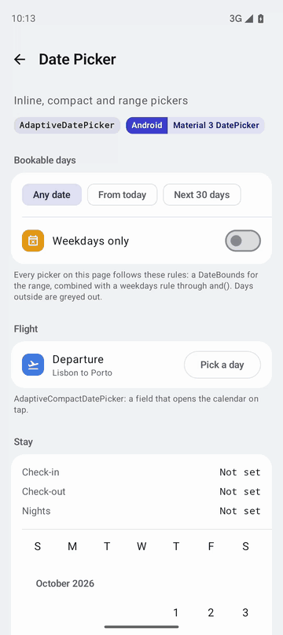
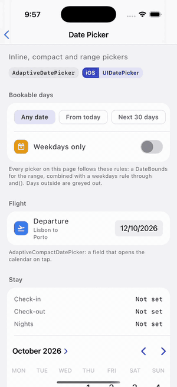
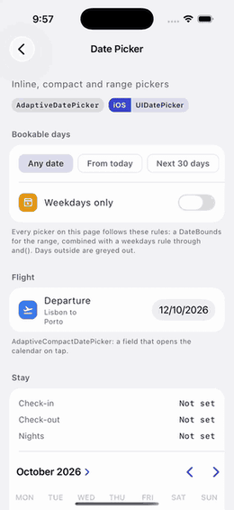

# Date Picker

Calf provides three date pickers that adapt to the platform they run on:

| Material (Android, Desktop, Web) | Cupertino (iOS < 26) | Liquid Glass (iOS 26+) |
| --- | --- | --- |
|  |  |  |

1. **AdaptiveDatePicker**: the full calendar, always visible. Material3 `DatePicker` on Android, Desktop and Web; `UICalendarView` (iOS 16+) or `UIDatePicker` on iOS.
2. **AdaptiveCompactDatePicker**: a field showing the selected date that opens the calendar on tap. A `DatePickerDialog` on Material platforms; the system compact `UIDatePicker` on iOS.
3. **AdaptiveDateRangePicker**: picks a start and an end day. Material3 `DateRangePicker` on Material platforms; a native multi-date `UICalendarView` on iOS 16+.

The first two share `AdaptiveDatePickerState`, the range picker has its own `AdaptiveDateRangePickerState`. All of them support the same [selectable rules](#restricting-selectable-dates).

## Usage

The `AdaptiveDatePicker` uses a state object to manage and track the selected date. You can observe changes to the selected date through the state. Timestamps are UTC milliseconds at the start of the selected day.

```kotlin
// Create and remember the date picker state, optionally with an initial selection
val state = rememberAdaptiveDatePickerState(
    initialSelectedDateMillis = LocalDate(2026, 1, 1)
        .atStartOfDayIn(TimeZone.UTC)
        .toEpochMilliseconds(),
)

// React to date changes
LaunchedEffect(state.selectedDateMillis) {
    val selectedDate = state.selectedDateMillis?.let { millis ->
        Instant.fromEpochMilliseconds(millis).toLocalDateTime(TimeZone.UTC).date
    }
    println("Selected date: $selectedDate")
}

// Display the date picker
AdaptiveDatePicker(
    state = state,
    modifier = Modifier.fillMaxWidth(),
)
```

The examples use [kotlinx-datetime](https://github.com/Kotlin/kotlinx-datetime) for date math. Any source of UTC epoch milliseconds works.

### State

`rememberAdaptiveDatePickerState(...)` creates and remembers an `AdaptiveDatePickerState`, shared by `AdaptiveDatePicker` and `AdaptiveCompactDatePicker`.

| Member | Description | Platform notes |
|---|---|---|
| `var selectedDateMillis: Long?` | The UTC start of the selected day, or `null`. Observable. | Every platform. |
| `var displayedMonthMillis: Long` | The UTC start of the month the calendar shows. Observable. Setting it scrolls the calendar; a month outside `yearRange` is ignored. | Material: also follows the month the user scrolls to. iOS 16+ inline calendar: scrolls to it, and selecting a day moves it to that day's month, which is what the native calendar does; iOS does not report the month the user scrolls to. Wheels and compact picker: only stored. |
| `var displayMode: DisplayMode` | Calendar or text input. | Material only. |
| `var selectableDates: SelectableDates` | The rule deciding which days can be picked, see below. | Every platform. |
| `val yearRange: IntRange` | The years the picker is limited to. | Every platform. |
| `val initialUIKitDisplayMode: UIKitDisplayMode` | Calendar or wheels. | iOS only. |
| `val locale: CalendarLocale` | The locale used to format dates and to choose the input format: the system default when the state was created. | Every platform. |

```kotlin
val state = rememberAdaptiveDatePickerState()

// Scroll the calendar to the current month without changing the selection
Button(onClick = { state.displayedMonthMillis = thisMonthMillis }) { Text("Jump to this month") }
```

### Material-only parameters

`AdaptiveDatePicker` and `AdaptiveDateRangePicker` take the Material3 parameters `dateFormatter`, `title`, `headline`, `showModeToggle`, `colors` and `focusRequester`. `focusRequester` is the requester the text field takes in input mode, so it is focused as soon as the mode opens; pass `null` to leave the field unfocused. iOS has no input mode and ignores all of them except `colors`, whose selected day color tints the native picker.

## Restricting selectable dates

Every picker takes a Material3 `SelectableDates` rule through `selectableDates`. Calf ships `DateBounds` for the common case of a minimum and maximum day, and an infix `and` to combine rules.

### Bounds

```kotlin
val today = Clock.System.todayIn(TimeZone.currentSystemDefault())

val state = rememberAdaptiveDatePickerState(
    selectableDates = DateBounds(
        minDateMillis = today.atStartOfDayIn(TimeZone.UTC).toEpochMilliseconds(),
        maxDateMillis = today.plus(30, DateTimeUnit.DAY)
            .atStartOfDayIn(TimeZone.UTC)
            .toEpochMilliseconds(),
    ),
)
```

Both bounds are inclusive and compared per UTC day, so any timestamp inside the first or last day keeps that whole day selectable. A `null` bound is open on that side. Besides greying out days, bounds are applied natively: the iOS wheels stop at the range and the calendars hide the months outside it, using the same calendar day in the device time zone. If the current selection falls outside a new range, it is moved to the nearest selectable day on every platform.

The rule is an observable property of the state, so it can depend on other state. A typical case is a date range where the end date cannot come before the start date:

```kotlin
val startState = rememberAdaptiveDatePickerState()
val endState = rememberAdaptiveDatePickerState(
    selectableDates = DateBounds(minDateMillis = startState.selectedDateMillis),
)
```

`DateBounds` is a data class, so passing an equal value on recomposition changes nothing.

### Rules for individual days

Rules that a min/max range cannot express, such as excluding weekends, are plain `SelectableDates` implementations. Combine them with bounds using `and`:

```kotlin
val weekdaysOnly = remember {
    object : SelectableDates {
        override fun isSelectableDate(utcTimeMillis: Long): Boolean {
            val day = Instant.fromEpochMilliseconds(utcTimeMillis)
                .toLocalDateTime(TimeZone.UTC)
                .date
                .dayOfWeek
            return day != DayOfWeek.SATURDAY && day != DayOfWeek.SUNDAY
        }
    }
}

val state = rememberAdaptiveDatePickerState(
    selectableDates = DateBounds(minDateMillis = todayMillis) and weekdaysOnly,
)
```

Pass a stable instance, such as an `object`, a data class or a remembered value, so the picker is not re-evaluated on every recomposition.

| Platform | Behaviour |
|---|---|
| Material (Android, Desktop, Web) | Rejected days are disabled in the calendar grid. `isSelectableYear` disables years in the year picker. |
| iOS 16+ calendars (inline and range) | Backed by `UICalendarView`: rejected days are greyed out and cannot be tapped. Bounds coming from a `DateBounds` also hide the months outside the range. |
| iOS compact picker, wheels (`UIKitDisplayMode.Wheels`) and inline below iOS 16 | Backed by `UIDatePicker`, which cannot grey out days. Bounds coming from a `DateBounds` apply natively; picking any other rejected day snaps the control to the nearest selectable day. |

On every platform, a current selection that a new rule rejects is moved to the nearest selectable day. `isSelectableYear` has no effect on iOS.

## Compact picker

`AdaptiveCompactDatePicker` takes the same state as `AdaptiveDatePicker`, so the bounds and rules apply unchanged. It is the right choice for forms and for anything that should not take the full height of a calendar.

```kotlin
val state = rememberAdaptiveDatePickerState()

AdaptiveCompactDatePicker(
    state = state,
    enabled = true,
    // Material only: the field placeholder and the dialog buttons.
    materialPlaceholder = "Select date",
    materialConfirmText = "OK",
    materialDismissText = "Cancel",
)
```

The `material*` parameters configure the Material dialog and are ignored on iOS:

| Parameter | Default | Description |
|---|---|---|
| `materialPlaceholder` | `"Select date"` | Field text while nothing is selected. |
| `materialConfirmText`, `materialDismissText` | `"OK"`, `"Cancel"` | Labels of the dialog buttons. |
| `materialTitle`, `materialHeadline` | `null` | Dialog slots; `null` shows the Material3 defaults. |
| `materialShowModeToggle` | `true` | Whether the dialog offers the text input mode. |
| `materialFocusRequester` | `remember { FocusRequester() }` | Requester the text field takes in input mode; `null` leaves it unfocused. |
| `materialDialogShape` | `DatePickerDefaults.shape` | Shape of the dialog. |
| `materialDialogTonalElevation` | `DatePickerDefaults.TonalElevation` | Tonal elevation of the dialog. |
| `materialDialogProperties` | `DialogProperties(usePlatformDefaultWidth = false)` | Platform properties of the dialog, such as whether tapping outside dismisses it. |

The dialog opens on the selected day's month, or on `state.displayedMonthMillis` while nothing is selected.

| Platform | Behaviour |
|---|---|
| Material (Android, Desktop, Web) | An outlined button with the formatted date opens a `DatePickerDialog`. The day picked in the dialog reaches the state only on confirm; dismiss, or tapping outside, discards it. |
| iOS | The system compact `UIDatePicker`, which pops its calendar over the content. Changes apply immediately, as they do everywhere in iOS. Bounds coming from a `DateBounds` apply natively; the control cannot grey out days any other rule rejects, so such a pick snaps to the nearest selectable day. |

## Range picker

`AdaptiveDateRangePicker` selects a start and an end day. Its state exposes `selectedStartDateMillis` and `selectedEndDateMillis`, both UTC start-of-day timestamps, `setSelection(start, end)`, the observable `displayedMonthMillis` (the month the Material picker shows; setting it scrolls there, and the iOS 16+ calendar, which manages its own scrolling, only stores it), `displayMode`, `yearRange`, `selectableDates` and `locale`.

```kotlin
val rangeState = rememberAdaptiveDateRangePickerState(
    selectableDates = DateBounds(minDateMillis = todayMillis) and weekdaysOnly,
)

AdaptiveDateRangePicker(state = rangeState)

Text("From ${rangeState.selectedStartDateMillis} to ${rangeState.selectedEndDateMillis}")
```

| Platform | Behaviour |
|---|---|
| Material (Android, Desktop, Web) | The Material3 `DateRangePicker`, including its text input mode. It scrolls through months, so it needs a bounded height: inside a vertically scrolling column it falls back to `DateRangePickerFallbackHeight` (568 dp) unless you pass a `height` modifier. |
| iOS 16+ | A native `UICalendarView` with multi-date selection. The first tap picks the start, a tap on or after it picks the end, a tap before it moves the start, and any tap on a completed range starts a new one. Every day of the range is highlighted, rejected days are greyed out. |
| iOS below 16 | The Material3 `DateRangePicker`. |

Unlike the single-date state, a range is not moved automatically when the rule changes. It is validated when set: an end before the start, or an end without a start, clears the whole selection.

> `AdaptiveDatePicker` has no `dateValidator` parameter. An earlier version of this page documented one that never existed. Use `selectableDates` with `DateBounds` as described above instead.
