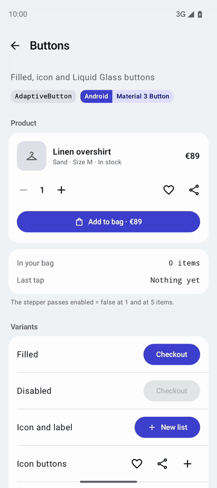
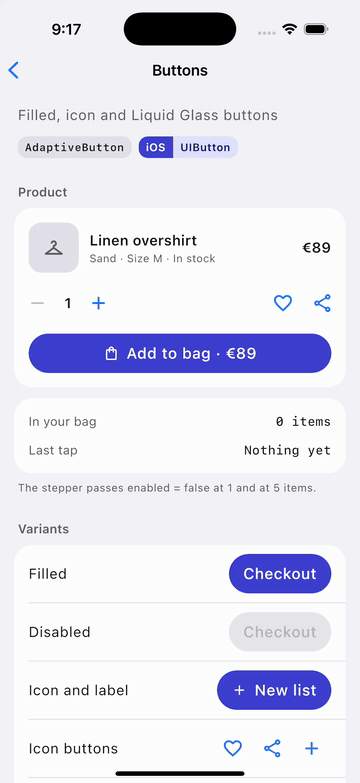
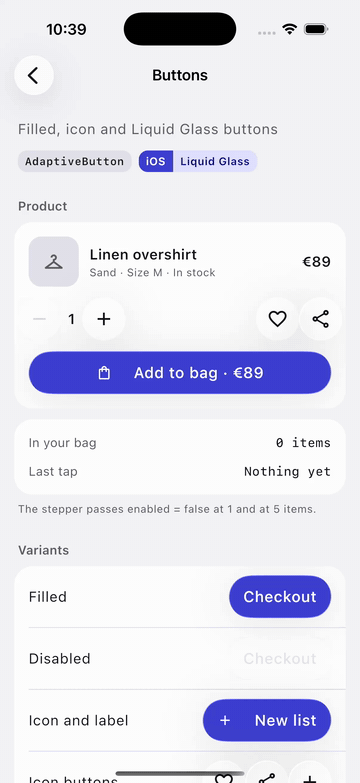

# Icon Button

`AdaptiveIconButton` is an icon button composable that adapts to the platform it is running on. On Android, Desktop, and Web, it uses the Material `IconButton`. On iOS < 26, it uses a Cupertino-style icon button, and on iOS 26+, it uses a Liquid Glass icon button.

| Material (Android, Desktop, Web) | Cupertino (iOS < 26) | Liquid Glass (iOS 26+) |
| --- | --- | --- |
|  |  |  |

## Usage

```kotlin
AdaptiveIconButton(
    onClick = { /* Handle click */ },
) {
    Icon(
        imageVector = Icons.Default.Favorite,
        contentDescription = "Favorite",
    )
}
```

## Parameters

| Parameter            | Description                                                                                                  |
|----------------------|--------------------------------------------------------------------------------------------------------------|
| `onClick`            | Called when the icon button is clicked.                                                                       |
| `modifier`           | The modifier to be applied to the icon button.                                                               |
| `enabled`            | Whether the icon button is enabled or disabled.                                                              |
| `colors`             | The colors for the icon button on Material platforms. Uses `IconButtonDefaults.iconButtonColors()` by default.|
| `shape`              | The shape of the container and of the ripple. Uses `IconButtonDefaults.standardShape` by default. Material only, ignored on iOS. |
| `liquidGlassColors`  | Optional color configuration for the Liquid Glass button style on iOS 26+.                                   |
| `interactionSource`  | The `MutableInteractionSource` for the icon button.                                                          |
| `content`            | The content of the icon button (typically an `Icon` composable).                                             |

## Liquid Glass Colors

On iOS 26+, you can customize the Liquid Glass icon button appearance using `LiquidGlassButtonColors`:

```kotlin
AdaptiveIconButton(
    onClick = { /* Handle click */ },
    liquidGlassColors = LiquidGlassButtonDefaults.filledButtonColors(
        tintColor = Color.Blue,
        contentColor = Color.White,
    ),
) {
    Icon(
        imageVector = Icons.Default.Favorite,
        contentDescription = "Favorite",
    )
}
```

## Example

```kotlin
// Basic usage
AdaptiveIconButton(
    onClick = { println("Icon button clicked!") },
) {
    Icon(
        imageVector = Icons.Default.Favorite,
        contentDescription = "Favorite",
    )
}

// With custom colors
AdaptiveIconButton(
    onClick = { /* Handle click */ },
    colors = IconButtonDefaults.iconButtonColors(
        contentColor = Color.Red,
    ),
) {
    Icon(
        imageVector = Icons.Default.Delete,
        contentDescription = "Delete",
    )
}

// Squared tonal container: shape is Material only, iOS keeps the platform button
AdaptiveIconButton(
    onClick = { /* Handle click */ },
    colors = IconButtonDefaults.filledTonalIconButtonColors(),
    shape = MaterialTheme.shapes.small,
) {
    Icon(
        imageVector = Icons.Default.Edit,
        contentDescription = "Edit",
    )
}

// Disabled icon button
AdaptiveIconButton(
    onClick = { /* Handle click */ },
    enabled = false,
) {
    Icon(
        imageVector = Icons.Default.Settings,
        contentDescription = "Settings",
    )
}
```
