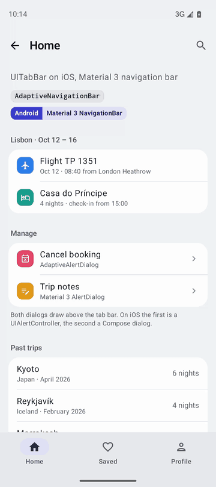
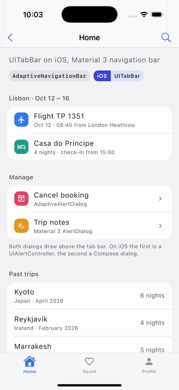
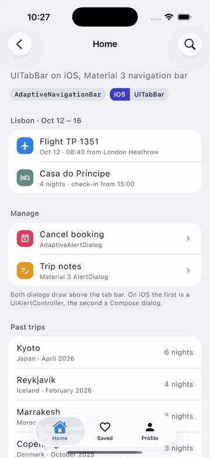
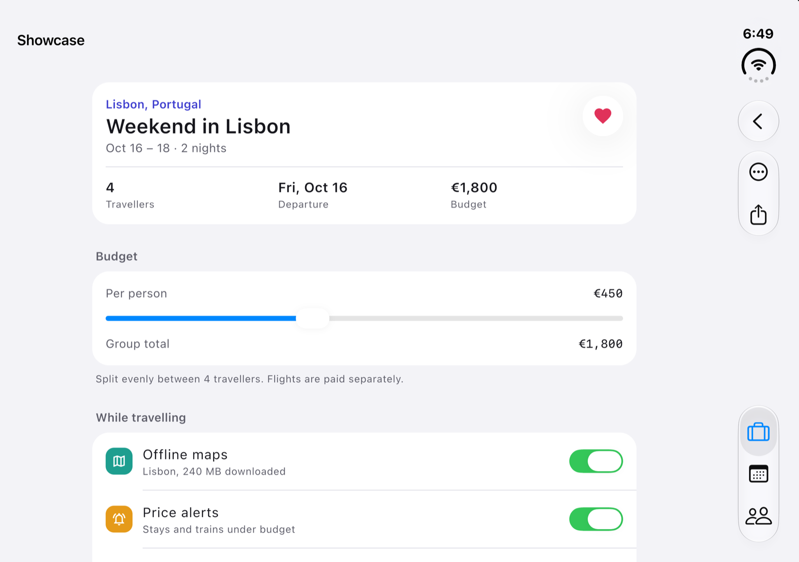

# Navigation Bar

`AdaptiveNavigationBar` is an adaptive navigation bar that uses UIKit's `UITabBar` on iOS and Material3's `NavigationBar` on other platforms (Android, Desktop, Web).

On iOS, the native UITabBar is created using the `iosItems`, `iosSelectedIndex`, and `iosOnItemSelected` parameters. On Material platforms, the `content` lambda is used to provide full customization of the NavigationBar content (typically `NavigationBarItem`s).

| Material (Android, Desktop, Web) | Cupertino (iOS < 26) | Liquid Glass (iOS 26+) |
| --- | --- | --- |
|  |  |  |

!!! tip "Navigating between screens with tabs?"
    `AdaptiveNavigationBar` is a bar view laid over your Compose content. On iOS it cannot follow a Navigation 3 transition (it disappears only after the exit animation and reappears at the start of a back swipe). If your tabs own navigation stacks, use [`AdaptiveTabDisplay`](../navigation.md) from `calf-navigation` instead: it hosts a real `UITabBarController`, so the tab bar rides every transition natively.

## Usage

```kotlin
@OptIn(ExperimentalCalfUiApi::class)
@Composable
fun MyNavigationBar() {
    var selectedIndex by remember { mutableIntStateOf(0) }
    val items = listOf("Home", "Search", "Profile")

    AdaptiveNavigationBar(
        // Material content
        content = {
            items.forEachIndexed { index, item ->
                NavigationBarItem(
                    selected = selectedIndex == index,
                    onClick = { selectedIndex = index },
                    icon = { Icon(Icons.Default.Home, contentDescription = item) },
                    label = { Text(item) },
                )
            }
        },
        // iOS-specific parameters
        iosItems = items.map { title ->
            UIKitUITabBarItem(title = title)
        },
        iosSelectedIndex = selectedIndex,
        iosOnItemSelected = { selectedIndex = it },
    )
}
```

## Parameters

| Parameter            | Description                                                                                                  |
|----------------------|--------------------------------------------------------------------------------------------------------------|
| `modifier`           | The modifier to be applied to the navigation bar.                                                            |
| `containerColor`     | The color used for the background of this navigation bar.                                                    |
| `contentColor`       | The preferred color for content inside this navigation bar.                                                  |
| `tonalElevation`     | The tonal elevation of this navigation bar.                                                                  |
| `windowInsets`       | The window insets to be applied to the navigation bar.                                                       |
| `iosItems`           | The list of tab bar items for the iOS UITabBar. See `UIKitUITabBarItem`.                                     |
| `iosSelectedIndex`   | The index of the currently selected item on iOS.                                                             |
| `iosOnItemSelected`  | Callback invoked when an item is selected on iOS, with the item index.                                       |
| `iosConfiguration`   | Configuration for the iOS UITabBar appearance (item tint colors, translucency). See `UIKitTabBarConfiguration`. |
| `content`            | The content of the navigation bar on Material platforms, typically `NavigationBarItem`s within a `RowScope`.  |

## Content padding on iOS

On iOS the bar is a native `UITabBar` that Compose never measures. Inside an `AdaptiveScaffold`, the bar reports the room it takes and the scaffold adds it to the bottom of the `PaddingValues` it hands to `content`. The padding is updated when the device rotates and when the safe area changes. See [Top Bar](adaptive-top-bar.md#content-padding-on-ios).

## Inside the bar host (iOS)

With [`AdaptiveBarHostUIViewController`](../ui.md#installing-the-bar-host-ios) as the app's iOS entry point, up to five items become the tabs of the host's `UITabBarController`. Selection works both ways: `iosSelectedIndex` selects the tab, and a tap on a tab calls `iosOnItemSelected`. Your Compose content is not split per tab: the one Compose hierarchy moves into the selected tab, so its state and your own tab transitions are kept.

The tab bar belongs to the screen whose `AdaptiveScaffold` shows it, and to the screens nested inside that scaffold's content. When a screen outside it takes the bars, a pushed detail for example, the tab bar hides at the start of the transition instead of staying over the new screen. On an iPhone Duo the tab bar moves into the vertical bar.

With more than five items the bar stays standalone: a `UITabBarController` would move the rest behind its own "More" tab.



## iOS Configuration

You can customize the iOS tab bar appearance using `UIKitTabBarConfiguration`:

```kotlin
AdaptiveNavigationBar(
    iosItems = items,
    iosSelectedIndex = selectedIndex,
    iosOnItemSelected = { selectedIndex = it },
    iosConfiguration = UIKitTabBarConfiguration(
        selectedItemColor = Color.Red,
        unselectedItemColor = Color.Gray,
        isTranslucent = true,
    ),
    content = { /* Material content */ },
)
```

| Property              | Description                                                                                                |
|-----------------------|------------------------------------------------------------------------------------------------------------|
| `selectedItemColor`   | Tint color for selected tab bar items (icon + label). Maps to `UITabBar.tintColor`. Default: iOS system blue. |
| `unselectedItemColor` | Color for unselected tab bar items (icon + label). Note: Liquid Glass (iOS 26+) ignores this property; not yet supported. |
| `isTranslucent`       | Whether the tab bar is translucent. Default: `true`.                                                       |

## iOS Tab Bar Items

Use `UIKitUITabBarItem` to define items for the iOS UITabBar:

```kotlin
UIKitUITabBarItem(
    title = "Home",
    image = UIKitImage.SystemName(SFSymbol.house),
    selectedImage = UIKitImage.SystemName(SFSymbol.houseFill),
)
```

!!! tip
    Use type-safe `SFSymbol` constants from `calf-ui` instead of raw strings. See [SF Symbols & Cupertino Icons](../sf-symbols.md) for details.
