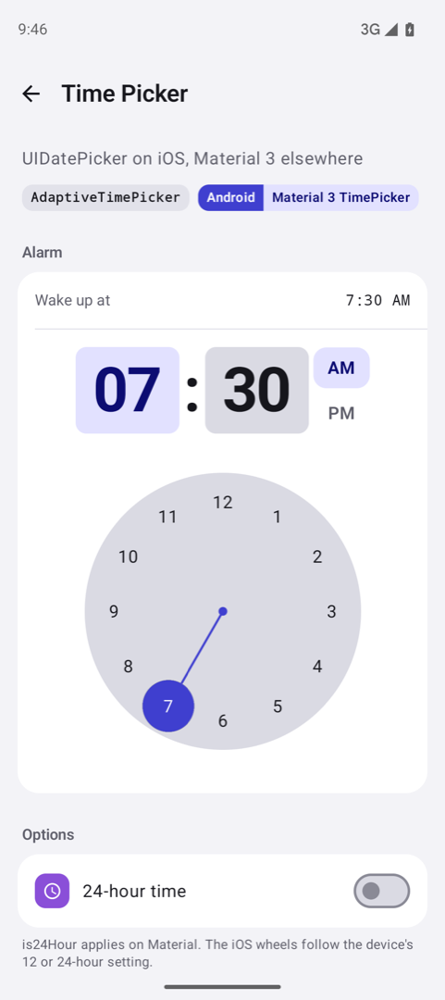
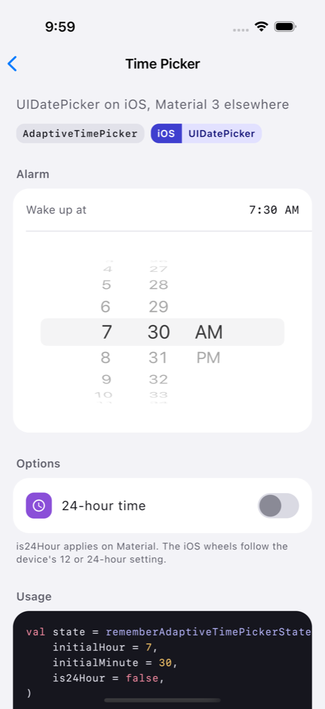
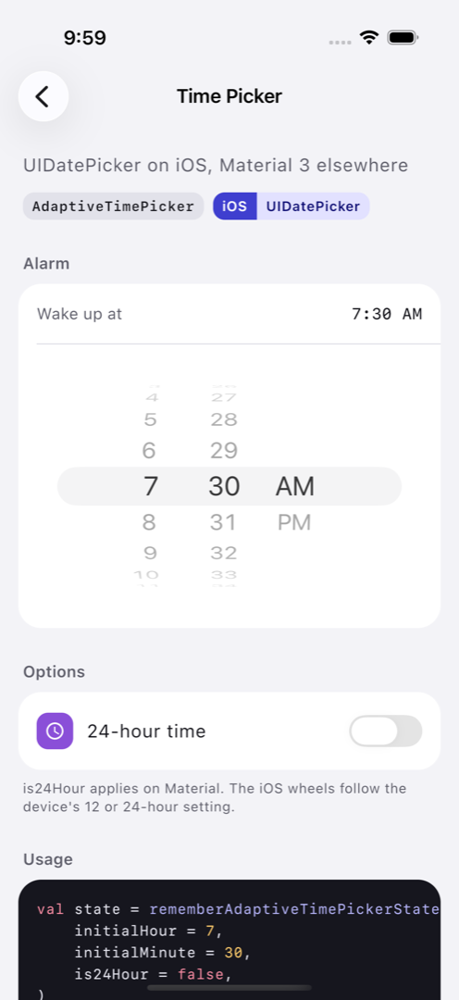

# Time Picker

`AdaptiveTimePicker` is a time picker that adapts to the platform it is running on. It is a wrapper around the Material3 `TimePicker` on Android, Desktop and Web, and around `UIDatePicker` (in time mode) on iOS, providing a native time selection experience on each platform.

| Material (Android, Desktop, Web) | Cupertino (iOS < 26) | Liquid Glass (iOS 26+) |
| --- | --- | --- |
|  |  |  |

## Usage

The `AdaptiveTimePicker` uses a state object to hold the selected time. Observe `hour` and `minute` to react to changes, or assign them to move the picker.

```kotlin
// Create and remember the time picker state. is24Hour defaults to the device setting.
val state = rememberAdaptiveTimePickerState(
    initialHour = 14,
    initialMinute = 30,
)

// React to time changes
LaunchedEffect(state.hour, state.minute) {
    val formatted = "${state.hour.toString().padStart(2, '0')}:${state.minute.toString().padStart(2, '0')}"
    println("Selected time: $formatted")
}

// Display the time picker
AdaptiveTimePicker(
    state = state,
    modifier = Modifier.fillMaxWidth(),
)

// Move the picker from code
Button(onClick = { state.hour = 9; state.minute = 30 }) { Text("Set 09:30") }
```

## State

`rememberAdaptiveTimePickerState(initialHour, initialMinute, is24Hour)` creates and remembers an `AdaptiveTimePickerState`. The state survives configuration changes through `rememberSaveable`.

| Member | Description | Platform notes |
|---|---|---|
| `var hour: Int` | The selected hour, 0 to 23, whatever the format. Observable. Setting it moves the picker; a value out of range throws `IllegalArgumentException`. | Every platform. On iOS the wheels animate to the new time. |
| `var minute: Int` | The selected minute, 0 to 59. Observable. Setting it moves the picker; a value out of range throws. | Every platform. |
| `var is24hour: Boolean` | Whether the picker uses the 24-hour format. Observable. | Material: changing it re-lays out the picker in the other format. iOS: the wheels always follow the device's time format setting, so the value is only stored. |
| `val isPm: Boolean` | `true` when `hour` is 12 or later. An extension property. | Every platform. |

### Default hour format

`is24Hour` defaults to the device's time format setting, read once when the state is created. Earlier versions defaulted to `false`.

| Platform | How the default is read |
|---|---|
| Android | `DateFormat.is24HourFormat(context)`, the system "Use 24-hour format" setting. |
| Desktop | The default locale's short time pattern: a 24-hour clock when it uses an `H` or `k` hour field. |
| iOS | `NSDateFormatter.dateFormatFromTemplate("j")` for the current locale, which reflects the device's 24-Hour Time setting. The wheels follow the same setting. |
| Web | `Intl.DateTimeFormat().resolvedOptions().hour12` for the browser's locale; 12-hour when the browser cannot tell. |

Pass `is24Hour` explicitly to ignore the setting:

```kotlin
val state = rememberAdaptiveTimePickerState(is24Hour = true)
```

The format is only read when the state is created. To switch it later, assign `state.is24hour`, as the sample's "24-hour time" switch does.

## Platform behaviour

| Platform | Behaviour |
|---|---|
| Material (Android, Desktop, Web) | The Material3 `TimePicker`, with its `colors` and `layoutType`. |
| iOS | `UIDatePicker` wheels in time mode, configured with the device locale, so they show 12 or 24 hours as the device is set. The tint color comes from `colors.timeSelectorSelectedContainerColor`. |
