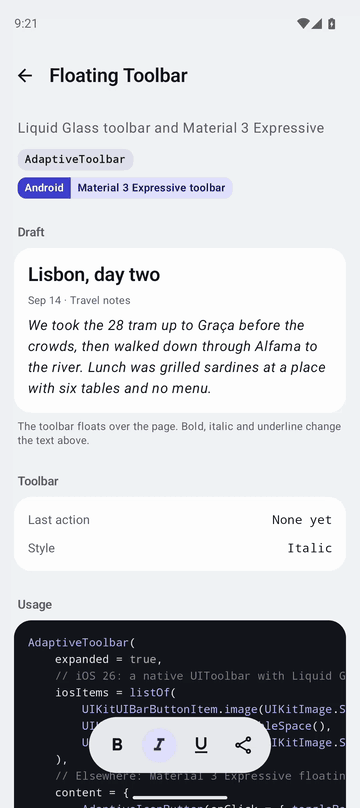
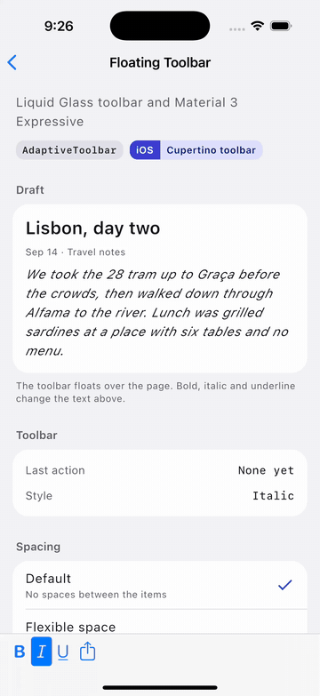
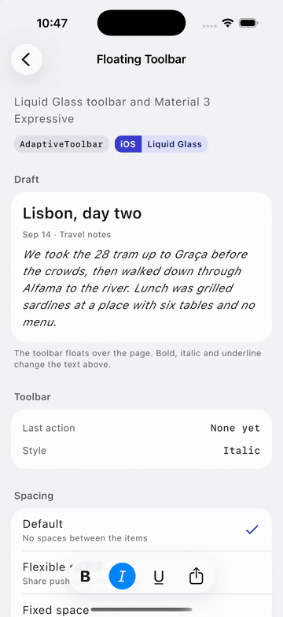

# Toolbar

`AdaptiveToolbar` is an adaptive toolbar that uses a native `UIToolbar` with Liquid Glass on iOS 26+ and a Material 3 Expressive `HorizontalFloatingToolbar` on other platforms (Android, Desktop, Web, and older iOS).

This toolbar is intended for contextual action buttons (not navigation), similar to a web browser's bottom toolbar with back, forward, share, and bookmark buttons.

| Material (Android, Desktop, Web) | Cupertino (iOS < 26) | Liquid Glass (iOS 26+) |
| --- | --- | --- |
|  |  |  |

## Usage

```kotlin
@OptIn(ExperimentalCalfUiApi::class)
@Composable
fun MyToolbar() {
    var expanded by remember { mutableStateOf(true) }

    AdaptiveToolbar(
        expanded = expanded,
        // Material content
        content = {
            IconButton(onClick = { /* back */ }) {
                Icon(Icons.AutoMirrored.Default.ArrowBack, contentDescription = "Back")
            }
            IconButton(onClick = { /* forward */ }) {
                Icon(Icons.AutoMirrored.Default.ArrowForward, contentDescription = "Forward")
            }
            IconButton(onClick = { /* share */ }) {
                Icon(Icons.Default.Share, contentDescription = "Share")
            }
        },
        // iOS-specific parameters
        iosItems = listOf(
            UIKitUIBarButtonItem.systemItem(
                systemItem = UIKitUIBarButtonSystemItem.Reply,
                onClick = { /* back */ }
            ),
            UIKitUIBarButtonItem.flexibleSpace(),
            UIKitUIBarButtonItem.systemItem(
                systemItem = UIKitUIBarButtonSystemItem.Action,
                onClick = { /* share */ }
            ),
        ),
    )
}
```

## Parameters

| Parameter            | Description                                                                                                      |
|----------------------|------------------------------------------------------------------------------------------------------------------|
| `expanded`           | Whether the toolbar is in its expanded state.                                                                    |
| `modifier`           | The modifier to be applied to the toolbar.                                                                       |
| `colors`             | The colors of the Material 3 Expressive floating toolbar. Uses `FloatingToolbarDefaults.standardFloatingToolbarColors()` by default. Material only, ignored on iOS. |
| `contentPadding`     | The padding around the floating toolbar's content. Uses `FloatingToolbarDefaults.ContentPadding` by default. Material only, ignored on iOS. |
| `scrollBehavior`     | Hides and shows the floating toolbar as the content under it scrolls, see `FloatingToolbarDefaults.exitAlwaysScrollBehavior`. Material only, ignored on iOS. |
| `shape`              | The shape of the floating toolbar's container. Uses `FloatingToolbarDefaults.ContainerShape` by default. Material only, ignored on iOS. |
| `leadingContent`     | Optional leading content for the Material 3 Expressive floating toolbar.                                         |
| `trailingContent`    | Optional trailing content for the Material 3 Expressive floating toolbar.                                        |
| `expandedShadowElevation` | The shadow elevation of the floating toolbar while expanded. Uses `FloatingToolbarDefaults.ContainerExpandedElevation` by default. Material only, ignored on iOS. |
| `collapsedShadowElevation` | The shadow elevation of the floating toolbar while collapsed. Uses `FloatingToolbarDefaults.ContainerCollapsedElevation` by default. Material only, ignored on iOS. |
| `content`            | The main content composable for the Material 3 Expressive floating toolbar. Typically a row of `IconButton`s.    |
| `iosItems`           | The list of bar button items for the iOS native toolbar. See `UIKitUIBarButtonItem`.                             |

## Scroll behavior and colors (Material)

On Material platforms the floating toolbar can slide away while the content under it scrolls and come back when the scroll reverses. Attach the behavior's nested scroll connection to the scrolling container and pass it to the toolbar; iOS ignores it and keeps the native toolbar in place.

```kotlin
val scrollBehavior = FloatingToolbarDefaults.exitAlwaysScrollBehavior(
    exitDirection = FloatingToolbarExitDirection.Bottom,
)

Column(
    modifier = Modifier
        .nestedScroll(scrollBehavior)
        .verticalScroll(rememberScrollState()),
) { /* page content */ }

AdaptiveToolbar(
    expanded = true,
    scrollBehavior = scrollBehavior,
    colors = FloatingToolbarDefaults.vibrantFloatingToolbarColors(),
    content = { /* icon buttons */ },
    iosItems = items,
)
```

## Inside the bar host (iOS)

With [`AdaptiveBarHostUIViewController`](../ui.md#installing-the-bar-host-ios) as the app's iOS entry point, `iosItems` become the `toolbarItems` of the host's `UINavigationController`: the system toolbar at the bottom of the screen, which appears and leaves with the screen that shows it. On an iPhone Duo its items join the vertical bar below the navigation bar's items; when the vertical bar is full they go to its overflow menu first.
