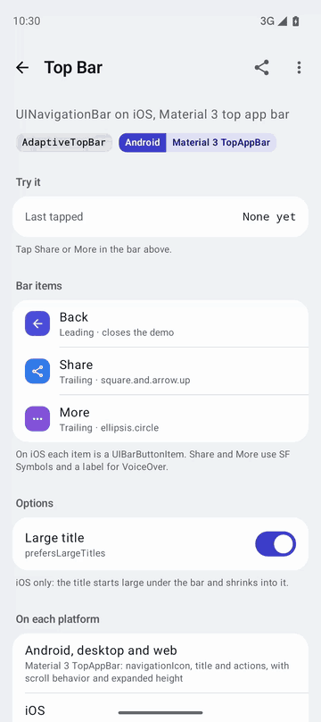
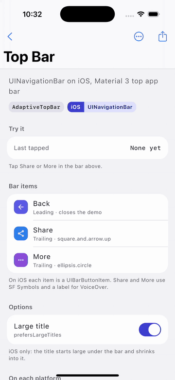
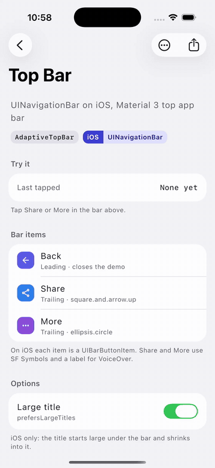
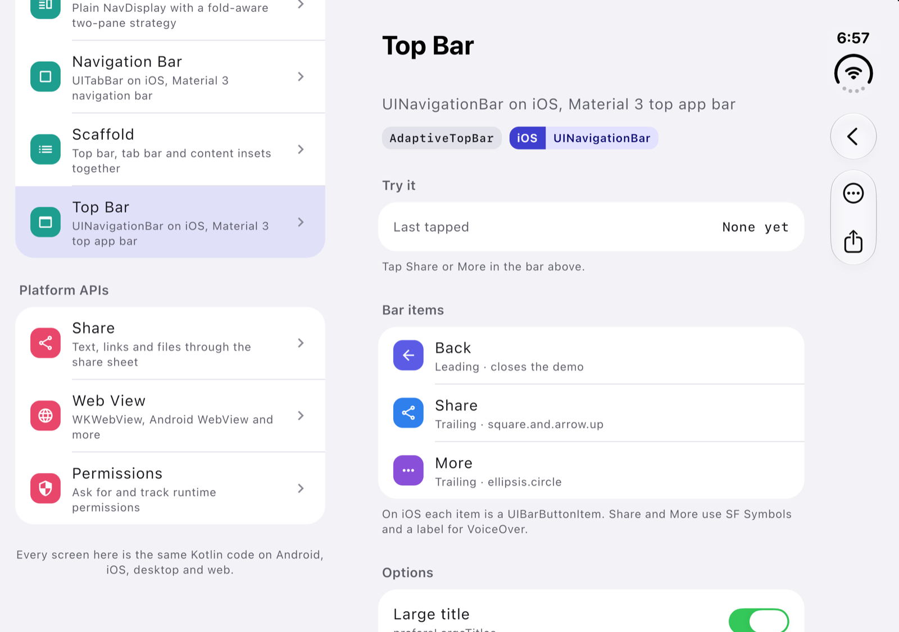
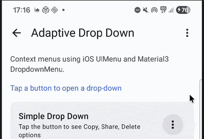
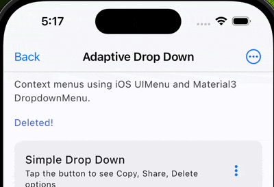
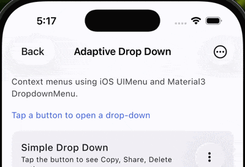

# Top Bar

`AdaptiveTopBar` is an adaptive top app bar that uses UIKit's `UINavigationBar` on iOS and Material3's `TopAppBar` on other platforms (Android, Desktop, Web).

On iOS, a native UINavigationBar is created using the `iosTitle`, `iosLeadingItems`, `iosTrailingItems`, and `iosConfiguration` parameters. On Material platforms, the standard Material3 `TopAppBar` parameters are used.

| Material (Android, Desktop, Web) | Cupertino (iOS < 26) | Liquid Glass (iOS 26+) |
| --- | --- | --- |
|  |  |  |

## Usage

```kotlin
@OptIn(ExperimentalMaterial3Api::class, ExperimentalCalfUiApi::class)
@Composable
fun MyScreen() {
    AdaptiveTopBar(
        title = { Text("My Screen") },
        navigationIcon = {
            IconButton(onClick = { /* navigate back */ }) {
                Icon(Icons.AutoMirrored.Default.ArrowBack, contentDescription = "Back")
            }
        },
        actions = {
            IconButton(onClick = { /* action */ }) {
                Icon(Icons.Default.Settings, contentDescription = "Settings")
            }
        },
        // iOS-specific parameters
        iosTitle = "My Screen",
        iosLeadingItems = listOf(
            UIKitUIBarButtonItem.systemItem(
                systemItem = UIKitUIBarButtonSystemItem.Close,
                onClick = { /* navigate back */ }
            )
        ),
        iosTrailingItems = listOf(
            UIKitUIBarButtonItem.title(
                title = "Settings",
                onClick = { /* action */ }
            )
        ),
    )
}
```

## Parameters

| Parameter            | Description                                                                                                      |
|----------------------|------------------------------------------------------------------------------------------------------------------|
| `modifier`           | The modifier to be applied to the top bar.                                                                       |
| `title`              | The title composable for Material3 TopAppBar.                                                                    |
| `navigationIcon`     | The navigation icon composable for Material3 TopAppBar.                                                          |
| `actions`            | The action icons composable for Material3 TopAppBar.                                                             |
| `expandedHeight`     | The expanded height of the Material3 TopAppBar.                                                                  |
| `windowInsets`       | The window insets for the Material3 TopAppBar.                                                                   |
| `colors`             | The colors for the Material3 TopAppBar. Uses `TopAppBarDefaults.topAppBarColors()` by default.                   |
| `scrollBehavior`     | The scroll behavior for the Material3 TopAppBar.                                                                 |
| `iosTitle`           | The title string for the iOS UINavigationBar.                                                                    |
| `iosLeadingItems`    | The list of bar button items on the leading side of the iOS navigation bar. See `UIKitUIBarButtonItem`.          |
| `iosTrailingItems`   | The list of bar button items on the trailing side of the iOS navigation bar. See `UIKitUIBarButtonItem`.         |
| `iosConfiguration`   | Configuration for the iOS UINavigationBar appearance. See `UIKitNavigationBarConfiguration`.                     |

## Content padding on iOS

On iOS the bar is a native `UINavigationBar` that Compose never measures. Inside an `AdaptiveScaffold`, the bar reports the room it takes and the scaffold adds it to the `PaddingValues` it hands to `content`, so apply that padding as you would with a Material `Scaffold`.

The padding follows the bar: it is updated when the device rotates, when the safe area changes (iPad Split View, a foldable changing pose) and when the bar's height changes. Side insets are part of it, so content also stays clear of the camera housing in landscape. The change is applied in one step, not animated, because UIKit moves the bar on its own clock.

## Inside the bar host (iOS)

With [`AdaptiveBarHostUIViewController`](../ui.md#installing-the-bar-host-ios) as the app's iOS entry point, the bar is the host's `UINavigationController` navigation bar instead of a standalone view. The same parameters apply: `iosTitle`, `iosLeadingItems`, `iosTrailingItems` and `iosConfiguration` describe what the bar shows while this screen owns it. The bar stays in place when Compose pushes or pops a screen, only the title and items crossfade; a large title collapses as the content scrolls; on an iPhone Duo the items move into the vertical bar.

The hosted bar has no back button of its own. Put one first in the leading items:

```kotlin
iosLeadingItems = listOf(
    UIKitUIBarButtonItem.back(onClick = navigateBack),
),
```



## iOS Configuration

You can customize the iOS navigation bar appearance using `UIKitNavigationBarConfiguration`:

```kotlin
AdaptiveTopBar(
    title = { Text("Large Title") },
    iosTitle = "Large Title",
    iosConfiguration = UIKitNavigationBarConfiguration(
        prefersLargeTitles = true,
        isTranslucent = true,
        titleColor = Color.Red,
    ),
)
```

| Property              | Description                                                                                              |
|-----------------------|----------------------------------------------------------------------------------------------------------|
| `prefersLargeTitles`  | Whether the navigation bar should display large titles. Default: `false`.                                |
| `isTranslucent`       | Whether the navigation bar is translucent. Default: `true`.                                              |
| `titleColor`          | The color of the navigation bar title text. When `Color.Unspecified`, the default iOS title color is used. |

## iOS Bar Button Items

Use `UIKitUIBarButtonItem` factory functions to create bar button items for iOS:

```kotlin
// Title-based item
UIKitUIBarButtonItem.title(
    title = "Done",
    onClick = { /* handle */ }
)

// System item
UIKitUIBarButtonItem.systemItem(
    systemItem = UIKitUIBarButtonSystemItem.Add,
    onClick = { /* handle */ }
)

// Flexible space (expands to fill available width)
UIKitUIBarButtonItem.flexibleSpace()

// Fixed-width space
UIKitUIBarButtonItem.fixedSpace(width = 16.0)

// Image item with a name for VoiceOver and the overflow menu
UIKitUIBarButtonItem.image(
    image = UIKitImage.Vector(Icons.Outlined.Notifications),
    label = "Notifications",
    visibilityPriority = UIKitUIBarButtonItemVisibilityPriority.Low,
    onClick = { /* handle */ }
)
```

### Labels and overflow

| Parameter | What it does |
|---|---|
| `label` | The item's name for VoiceOver and for the bar's overflow menu (iOS 26+ bars, and the vertical bar of an iPhone Duo). Defaults to `title`. The bar keeps showing the image; the label is only read and listed. System items and SF Symbols already have a name from UIKit; a Compose vector or bitmap has none until you give it one, and debug builds log a one-time reminder. |
| `visibilityPriority` | `UIKitUIBarButtonItemVisibilityPriority.Low`, `Standard` (default) or `High`. When the bar runs out of room, iOS 27+ moves `Low` items to the overflow menu first and `High` items last. Ignored before iOS 27. |

A text item is never moved into an iPhone Duo's vertical strip; it stays in the title row.

!!! tip
    Use type-safe `SFSymbol` constants from `calf-ui` instead of raw strings for icon names. See [SF Symbols & Cupertino Icons](../sf-symbols.md) for details.

### Bar Button Item with Menu

You can attach a native drop-down menu to a bar button item on iOS using `UIKitUIBarButtonItem.withMenu()`.
This uses the native `UIBarButtonItem.menu` API (iOS 14+), providing smooth system animations anchored to the bar button — no overlay hacks needed.

On Material platforms, use a standard `DropdownMenu` inside the `actions` slot.

| Material | Cupertino | Liquid Glass |
|----------|-----------|--------------|
|  |  |  |

```kotlin
@OptIn(ExperimentalMaterial3Api::class, ExperimentalCalfUiApi::class)
@Composable
fun MyScreen() {
    var expanded by remember { mutableStateOf(false) }

    AdaptiveTopBar(
        title = { Text("My Screen") },
        actions = {
            // Material platforms: standard DropdownMenu
            Box {
                IconButton(onClick = { expanded = true }) {
                    Icon(Icons.Filled.MoreVert, contentDescription = "More")
                }
                DropdownMenu(
                    expanded = expanded,
                    onDismissRequest = { expanded = false },
                ) {
                    DropdownMenuItem(
                        text = { Text("Edit") },
                        onClick = { expanded = false },
                    )
                    DropdownMenuItem(
                        text = { Text("Delete") },
                        onClick = { expanded = false },
                    )
                }
            }
        },
        // iOS: native pull-down menu on the bar button
        iosTitle = "My Screen",
        iosTrailingItems = listOf(
            UIKitUIBarButtonItem.withMenu(
                image = UIKitImage.SystemName(SFSymbol.ellipsisCircle),
                menuItems = listOf(
                    AdaptiveDropDownItem(
                        title = "Edit",
                        iosIcon = UIKitImage.SystemName(SFSymbol.pencil),
                        onClick = { /* handle */ },
                    ),
                    AdaptiveDropDownItem(
                        title = "Delete",
                        iosIcon = UIKitImage.SystemName(SFSymbol.trash),
                        isDestructive = true,
                        onClick = { /* handle */ },
                    ),
                ),
            ),
        ),
    )
}
```

!!! note
    When a menu is provided, the `onClick` of the bar button item is ignored — the menu is shown as the primary action.

See also: [Drop Down](adaptive-drop-down.md) for more details on `AdaptiveDropDownItem` and sections.
